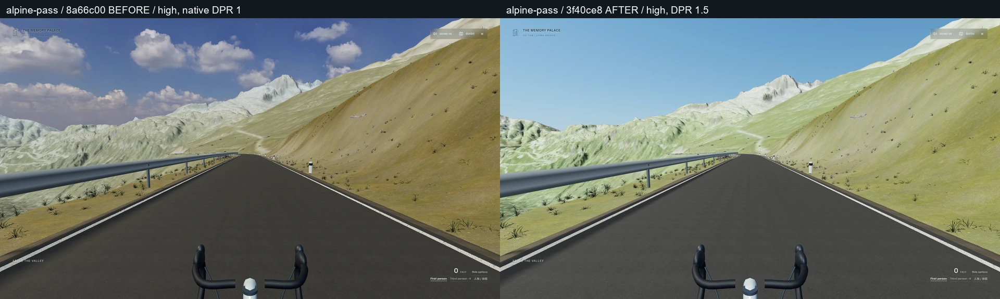
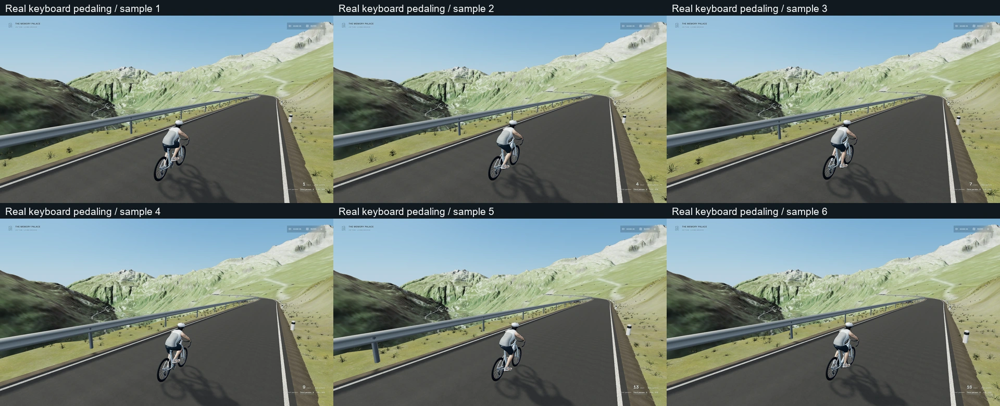

# 高山晴天、高清与骑姿修正

基线为 PR #24 的 `8a66c0083483f5dd9bf33df1903f060401f04cea`。独立分支 `codex/memory-palace-alpine-sun-rider` 保留此前两轮道路 / 环境、个人角色、篮球、博物馆、音乐 / 歌词、导入和返回系统。未 reset、force push、自动合并或更换主站发布入口。

本轮重新查看用户提供的[骑行参考视频](https://www.bilibili.com/video/BV1Tu4y187zN/)约 00:52、02:07 附近的公开画面，参考晴朗天空、明亮草甸、山谷明暗和紧凑骑姿。没有复制视频帧、游戏模型或音频；没有确认该视频的实际地点或渲染引擎。本项目继续使用原 Three.js / React Three Fiber，未安装另一套引擎。

## 独立提交与实际改动

| 提交 | 内容 |
| --- | --- |
| `3d07cde` | 晴天 / 薄雾偏好、天空辐亮度、地貌色彩、高清超采样、骑手手脚接触与前倾、滑行曲柄归位、蒙皮人物描边、轮胎窄接触遮蔽；新增单测与原生 QA。 |
| `3f40ce8` | 验收脚本遵循原踏频渐变的实际行为，改用真实下坡段观察滑行；调整 DPR 浮点容差及脚本空白。运行时代码与前一提交相同。 |

原图像色彩、草地和雾的多重压暗被减轻。晴天采用原日照方向、Three.js 自带的物理天空、单独的天空曝光 / 色平衡与更清楚的远景；不会为蓝天提高全场曝光。原小尺寸 HDR 仍负责反射 / 环境照明，只有一个已有主光阴影，没有增加全屏后处理、实时镜面或逐帧环境贴图。薄雾切换时主光、填充、反射与雾平滑过渡。

原 Canvas 在 DPR 1 屏幕的高档仍只渲染原生像素。现在高山桌面非低档可选择高清：1080p 实际 DPR **1.5 / 2880×1620**；1440p 受约六百万像素预算约束，DPR **1.276**。4K 不低于原生清晰度；低档、触屏及其他房间保留原策略。高清提高的是采样清晰度，并不会补出原航拍图片不存在的细节。

骑姿继续使用原模型、皮肤、骨骼、IK、路线速度与真实踏频。道路姿态收紧前倾，修正座位偏移、腕到掌的把位关系；由鞋底接触点反求踝关节，脚踝摆动后鞋底仍追随实际脚踏。松开踩踏、原踏频自然衰减后，视觉曲柄缓慢回到水平；没有更改重力、速度、转向、刹车、存档或创建第二个动作 / 物理时钟。

人物描边是约 **1.1 CSS px** 的蒙皮背面轮廓，复用原骨骼 / 网格，尊重深度遮挡，只给当前可见骑行角色绘制。它不新增渲染目标，篮球角色不受此改动影响。生命周期测试覆盖共享资源和 StrictMode 清理重播。

主要文件：`src/worlds/alpine/{daylight,visualPreferences,ClearSky,VisualOptions,Environment,Geography}`、`src/world/World.tsx`、`src/worlds/presence/{Avatar,riderPose,riderOutline}`、`src/worlds/road/RoadBike.tsx`。原 Hud 只接入三个视觉选项；未重新设计品牌或字体。新视觉偏好使用独立 localStorage 键，未改 IndexedDB 或原骑行存档结构。

## 使用

进入 `/alpine-ride`，原 E 上车、W / ↑ 踩踏、松开滑行、S / ↓ / Space 刹车、A / D 转向、V 切换视角继续可用。第三视角可用原鼠标拖拽查看侧面。

打开原 **Ride options**，选择 **天气 · 晴朗 / 山谷薄雾**、**画面 · 高清 / 原生**、**人物描边 · 开 / 关**。新用户默认晴朗、高清和描边；修改后刷新保留。薄雾是手动预设，不是动态云层、降雨或完整天气模拟。

本机可用入口：[含本地素材的开发预览](http://127.0.0.1:5190/alpine-ride) / [不含私有素材的生产预览](http://127.0.0.1:5191/alpine-ride)。仅为这台电脑的 localhost；尚未部署到主站。

## 实际画面与同机位比较

BEFORE 是干净的准确 `8a66c00`，AFTER 是干净的 `3f40ce8`。同一中性人物、空私人清单、存档距离、原相机、60° FOV、high 和窗口尺寸；光照与实际绘制分辨率是本轮有意修改的变量。三组 1080p 相机位置 / 四元数 / FOV 已核对，见[机位匹配报告](evidence/matched-cameras.json)。没有把新亮度造成的差异误称为同一照明状态。

| 1080p 同机位，左为基线 / 右为本轮 | 对照 |
| --- | --- |
| 山口第一人称 | [前后比较](evidence/compare-alpine-pass.webp) |
| 山谷第一人称 | [前后比较](evidence/compare-alpine-valley.webp) |
| 骑手后视 | [前后比较](evidence/compare-alpine-rider.webp) |

最终四个视点在 1920×1080 和 2560×1440 共八张实际截图均保留：[1080p 山口](evidence/1920-alpine-pass.webp)、[山谷](evidence/1920-alpine-valley.webp)、[后视](evidence/1920-alpine-rider.webp)、[侧视](evidence/1920-alpine-rider-side.webp)；[1440p 山口](evidence/2560-alpine-pass.webp)、[山谷](evidence/2560-alpine-valley.webp)、[后视](evidence/2560-alpine-rider.webp)、[侧视](evidence/2560-alpine-rider-side.webp)。实际查看了对照、两尺寸联系图及原尺寸侧视，检查明暗、轮廓、接触、UI、护栏和道路边线；[两尺寸检查图](evidence/resolution-check.webp)。

首次晴天过白和偏灰天空已拒绝并修改；原临时摄影变量会被 Player 输入覆盖，未成功的“侧视”实际仍是后视，不用作最终比较。基线另有两次公开版中段上车采集超时，未算通过；没有旧侧视 / 1440p 的有效同机位 BEFORE，本轮不伪造它们。原始失败日志 / PNG 留在本机忽略目录。WEBP 是同尺寸原 PNG 的压缩副本，联系图只缩小、并排和标注，没有后期调色或 AI 重画。

## 原生操作与自动验证

`npm test` **38 文件 / 207 单测通过**；`npx tsc -b`、`npm run lint`、`npm run build:public` 通过。公开构建 **2456 模块、66 可分享路由 / 52 索引路由**。[运行摘要](evidence/unit-tests.json)。原测试未删除；新 fixture 仅明确撤销本轮获授权的 Hud / 视觉曲柄 / 高山 DPR diff，原两轮与旧功能的源码摘要保护保留。

可见原生 Edge 使用真实步行、E 上车、鼠标、W 踩踏 / 松开、刹车、原按钮完成本轮 **5 项**检查：[原生报告](evidence/native-rider.json)。只在加载前写入正常路线存档；行程没有注入速度、踏频、相位或在骑行中改位置。六个真实踏频 / 骨骼样本见[踩踏序列](evidence/native-pedal-phases.webp)，右腕到本轮预定腕点的最大样本误差约 **0.85 mm**，见[原始数值](evidence/right-wrist-samples.json)。这是这六个中性人物动态样本，不是所有皮肤、静止姿态或极限转向的误差保证。

[滑行水平归位](evidence/03-coasting-level.webp)、[薄雾 / 原选项](evidence/04-valley-haze.webp)、[回馆恢复原 DPR](evidence/05-return-native-dpr.webp)均实际打开检查。天气、画面和描边切换 / 刷新恢复通过；先前脚本要求渐变踏频瞬间等于零导致失败，已改为等待原真实衰减和合理容差，没有为测试更改物理。

生产预览的原脚本：高山 **8 项**、森林 **7 项**通过，见[高山报告](evidence/public-alpine.json) / [森林报告](evidence/public-forest.json)。包含真实踩踏、惯性、换挡、刹车、照片保存、Guide / 音乐面板最上层 ESC、舒适 / 音效、刷新 / 返回；高山报告另覆盖两地图独立进度和双向切换。全部报告错误为空；新原生报告上传记录也为空。

[81.68 秒真实输入录屏](evidence/native-ride.mp4)为 1280×720 H.264、无音轨，展示上车、踩踏、滑行、偏好、刷新和返回流程；另查看了[录屏抽帧](evidence/recording-review.png)。它不是视频素材复刻、商业音乐展示或性能采样。截图 / 录屏与下方 GPU 测量分开执行。

## 真实硬件性能与范围

Windows、可见 Edge **148.0.3967.70**、ANGLE **NVIDIA GTX 1650 / D3D11**、1920×1080、high、实际 DPR **1.5**。三个静止视点各八秒；窗口始终可见有焦点，未与其他 GPU 任务并行，重复 RAF 不计作绘制帧。完整原始信息见[硬件与帧间隔报告](evidence/performance-high.json)。

| 视点 | 平均 FPS | P95 / 最大帧间隔 | 主通道 calls / triangles / textures |
| --- | ---: | --- | --- |
| 山口第一人称 | 80.8 | 14.1 / 97.3 ms | 126 / 2,561,999 / 38 |
| 山谷第一人称 | 81.8 | 14.1 / 83.2 ms | 77 / 2,165,836 / 41 |
| 骑手侧视 | 86.7 | 14.1 / 97.2 ms | 233 / 2,671,527 / 51 |

原两轮性能是 medium / DPR 1，本轮为 high / DPR 1.5，多绘制 2.25 倍像素，不能把这两组数字当相同负载的前后性能比较。仍存在最高约 97 ms 的帧间隔尖峰；没有测 1440p / 4K FPS、全高山十公里行程、长时间热稳态、GPU 计时器或精确显存。上述短静止样本不代表所有路线最低帧率。

## 私有素材与保留边界

[公开隐私报告](evidence/public-privacy.json)通过。另核对 `dist/personal-media` 仅有空 `manifest.json` 与 `avatar.json`，五类清单为空、人物 profile:null；无私有音乐、LRC、HTML、头像或浏览器导入输出。证据使用中性人物，录屏无商业音频，没有提交本地素材或清单。

公开 QA 后执行 `npm run media:register`，本机原有图片、音乐、项目和个人角色恢复；再次核对生产 `dist` 仍为空私人清单 / 中性角色。原 5190 dev、5191 public preview 进程保持运行。森林地图、路线 / 物理 / 输入、篮球、音乐引擎、歌词、IndexedDB、Cinema 返回、品牌、字体和站点旧入口保留。

## 仍存在的具体限制

- 山体的基础网格 / 航拍分辨率仍有限，部分坡面圆滑、影像拉伸和低频涂抹感可见；本轮没有重做高精度岩壁、山体扫描或新摄影测量素材。近景旧扫描物的少量接地误差仍在。
- 人物继续使用现有蒙皮与 IK，没有新的动作捕捉、布料模拟或全面指节抓握标定；旧个人照片 / 皮肤保留，不宣称本轮生成了更准确的肖像。
- 天气目前只有晴天与薄雾手动预设，没有移动云影、雨雪、昼夜或自动天气循环。不是完整天气引擎。
- 本轮画面比基线明亮、清楚，但尚未达到参考视频的山体资产、近景细节与完整场景真实度；未部署主站，不称为 AAA 等级或一比一还原。
