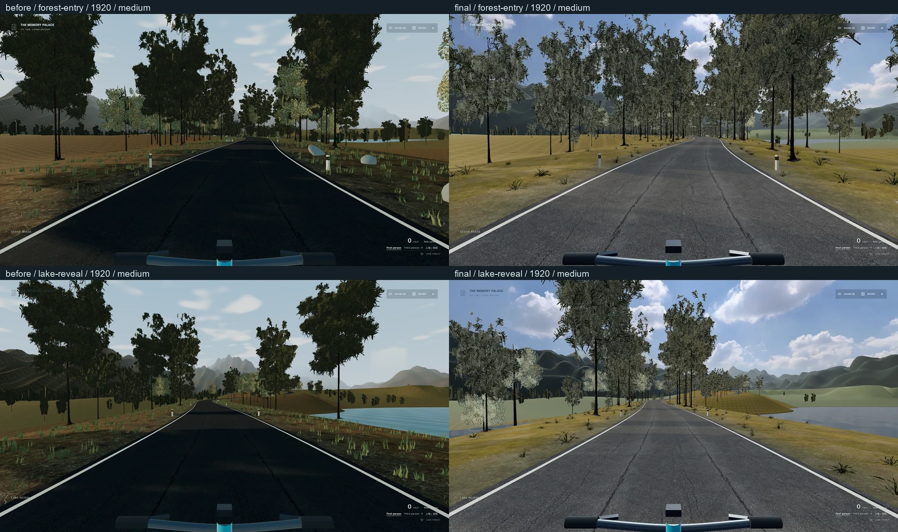

# 骑行环境美术验收（第一份指令）

基线 **48303b694e149f18b3d580fbc0d2ce1bc99cf730 / PR #22**；工作分支 `codex/memory-palace-cycling-environment-art`。原始博物馆、两条路线、骑行物理、人物、篮球、播放器、歌词、导入、存档和 Cinema 管线继续保留。本轮没有新地图、玩法、UI、相机摇晃、后处理或实时反射通道。

## 实际改动与保存点

| 提交 | 范围 |
| --- | --- |
| `4fbe833` | 共享 4K 实拍天空、原 2K HDR 环境反射；暖方向光与冷填充，同方向光照 |
| `267fbc3` | 真实沥青与法线的米制尺度、灰色干燥表面、边线老化和基本矿物路肩 |
| `42dc5d0` | 固定生态密度场、不同树冠/幼树、分级实拍草簇、扫描石；根部贴实际地表三角形 |
| `d8d5278` | 五组不同 DEM 裁窗构成远山；近地 PBR / 远地低频地貌色分工，高山原实测地形与影像投影保持 |
| `afb8b5d` | 水面按实际地表裁岸、深浅吸收、窄湿土带、少量岸草石；借用同一天空做有限 Fresnel 反射 |
| `1ba7684` | 原保护摘要不变，显式记录可撤销的获准美术 diff，继续检查其余原源码 |
| `06ea3e5` | 冷入口在提交阶段启动天空/HDR，再读取 Suspense；修正上一空间进度观察者的渲染期通知警告 |

实际渲染路径为 `WorldsBoundary → road/Experience / alpine/Experience → Landscape`。没有优化闲置旧骑行房间。主光还是各地图原方向，森林 6.4 m 路宽、曲率、坡度、停靠与碰撞采样未改。原第一/第三视角和舒适模式未改。

## 同机位画面

空私人清单、中性公开人物、medium、DPR 1、可见 Edge、减少动态冻结既有环境时间；真实有效存档距离，上车后只布置摄影朝向，**不作为连续骑行证据**。前后逐张检查位置距离小于 0.0001 m、四元数点积误差小于 0.000001、FOV 与窗口一致。1920×1080、2560×1440 各八张，八张分组对比均已实际查看。拼图只缩小原图，不调色。

| 视点 | 1080p 前后 | 1440p 前后 |
| --- | --- | --- |
| 森林入口 / 湖面揭示 | [对比 1](evidence/comparison-1920-1.webp) | [对比 1](evidence/comparison-2560-1.webp) |
| 高处俯瞰 / 近路面 | [对比 2](evidence/comparison-1920-2.webp) | [对比 2](evidence/comparison-2560-2.webp) |
| 湖岸 / 高山山口 | [对比 3](evidence/comparison-1920-3.webp) | [对比 3](evidence/comparison-2560-3.webp) |
| 高山谷地 / 高山近路面 | [对比 4](evidence/comparison-1920-4.webp) | [对比 4](evidence/comparison-2560-4.webp) |

真实原生操作的[森林第三视角](evidence/forest-third-native.webp)、[高山第三视角](evidence/alpine-third-native.webp)均已查看。原尺寸的 16 张最终 WebP 随本目录 evidence 保存；截图/姿态记录见 [before.json](evidence/before.json)、[after.json](evidence/after.json)。这些静态照片来源为 `1ba7684`；后续 `06ea3e5` 只改变加载启动时机，不改变静止构图。

## 测试与性能

类型检查、lint、**189 / 189 单测（35 文件）**通过。包含旧媒体、音乐、歌词、物理、路线、存档及新增材质所有权、生态接地、地貌预算、水面岸线测试。原保护 SHA 与原 18 项表面适配仍保留；不刷新原摘要来隐藏场景改写。

公开版森林 **8 项**、高山 **9 项**原生 DOM 操作通过：步行接近、上车、踩踏、换挡、真实惯性与制动、照片实际下载、Guide/音乐面板最上层 ESC、舒适选项、音效开关、两种视角、刷新恢复步行与返回；高山还验证双地图存档独立。记录：[森林](evidence/public-forest.json)、[高山](evidence/public-alpine.json)。早期高山相机检查在选项面板打开时寻找隐藏按钮而失败；修正测试操作顺序后通过，未修改产品行为。

Windows、可见 **Edge 148.0.3967.70**、**NVIDIA GTX 1650 / D3D11**、1920×1080、DPR 1、medium。没有与其他截图/录屏/GPU 验证并行。下表每个视点静止采样八秒，排除没有实际渲染的重复 RAF，确认窗口可见/有焦点。

| 同机位 | 基线平均 FPS | 第一轮平均 FPS | 第一轮 P95 / 最大帧间隔 | 主通道 calls / triangles / textures |
| --- | ---: | ---: | --- | --- |
| 森林入口 | 120.2 | 116.5 | 14.0 / 55.6 ms | 99 / 1,832,905 / 36 |
| 湖面揭示 | 140.9 | 139.3 | 7.1 / 41.6 ms | 102 / 1,156,825 / 36 |
| 高处俯瞰 | 141.3 | 140.8 | 7.1 / 48.6 ms | 59 / 261,939 / 39 |
| 高山山口 | 138.0 | 133.3 | 7.3 / 83.2 ms | 120 / 2,404,885 / 38 |
| 高山谷地 | 139.7 | 137.3 | 7.1 / 83.4 ms | 75 / 2,117,850 / 41 |

[完整基线采样](evidence/performance-before.json)、[完整第一轮采样](evidence/performance-after.json)。这不是全路线最低 FPS、GPU timer 或热稳态成绩。renderer.info 是主通道计数，未合计阴影/PMREM；纹理数量不是 VRAM。活动场景只有原太阳和半球灯，没有新常驻动态灯。

最终完整原生行程 **21 / 21 PASS**，连续主体路线 **395.75 秒**。使用正常键盘、按钮和原 Pedal continuously；全过程没有距离/镜头注入，最多六个分区。包括爬坡、湖边渐停、照片保存、山顶、真实重力下坡、制动、两级速度转向、Cinema 返回与重新进馆。唯一显式 NaN 故障在行程结束后注入，恢复测试与正常行程分开。Cinema 位置差 **0.000362 m**、朝向差 **0.00000178 rad**；实际环境 AudioContext RMS **0.002788**，没有商业音频。

同次行程的独立 **20 秒原生 W 踩踏**为 **109.3 FPS 平均、14.0 ms P95、340.3 ms 最大帧间隔**；峰值主通道 114 calls / 1,987,683 triangles / 40 textures。移动分区构建仍有明显偶发停顿，这一项没有被静止均值掩盖；不宣称全过程保持 45 FPS 最低值。原失败行程通过功能项但包含冷加载 React 警告，保留本机失败记录；修正准备时机后完整重跑，错误列表为空。

[原生行程与移动采样报告](evidence/native-journey.json)记录实际来源：`1ba7684` 上的准备层补丁在该次行程期间保存为 `06ea3e5`，几何和控制未变；没有把报告的启动 SHA 改成另一次运行。脚本已保存为 `scripts/check-cycling-art-journey.mjs`，另有 `scripts/capture-cycling-art.mjs` 复现两种分辨率的静态机位。旧 QA 脚本保留。

公开生产构建 **2447 模块、66 路由 / 52 索引路由**通过；`check-alpine-public.mjs` 确认五个私人清单均为空，无私人音频/LRC/HTML/collection，原 `/`、`/museum/`、`/legacy/` 入口存在。公开人物配置为 `profile:null`，没有私人 `avatar-head.png`。

## 限制与边界

远山使用低频地貌顶点色，远林仍是两片实拍树冠卡片；近场是有明确 CC0 来源的简化资产。这不是扫描写实世界，也不宣称达到 UE5、Forza 或 AAA 引擎质量。森林远山重排了既有 swissALTI3D 数据窗口，不把原创森林地图说成实测地点。原高山地图仍使用原地形、原投影和原真实道路。

湖面只有天空反射，**没有山体、树木和自行车倒影**。没有新增云动画、天气、车辆、人物 AI、光束后处理或额外镜面。

未测：1440p 性能、DPR 2、长时间热稳态和实体移动设备；1440p 验证的是静态画面和布局。本轮不重新运行每一条历史博物馆浏览器长旅程；所有旧单测保留，涉及跨空间的原生返回与公开入口另作验证。

原文第二份的更细沥青、碎边、砾石和排水应在本轮全部验收后另起分支，不能把第一轮和第二轮混成一个提交。

素材归属、转换与限制见 [road/SOURCES.md](../../public/media/road/SOURCES.md)、[alpine/SOURCES.md](../../public/media/alpine/SOURCES.md)。私人目录、商业音乐、LRC、HTML、清单和浏览器导入不进入本目录证据或公开 Git。

本地入口：[森林骑行](http://127.0.0.1:5190/cycling)、[高山骑行](http://127.0.0.1:5190/alpine-ride)、[公开构建](http://127.0.0.1:5191/cycling)。只表示这台机器上的预览；没有合并或部署主站。
