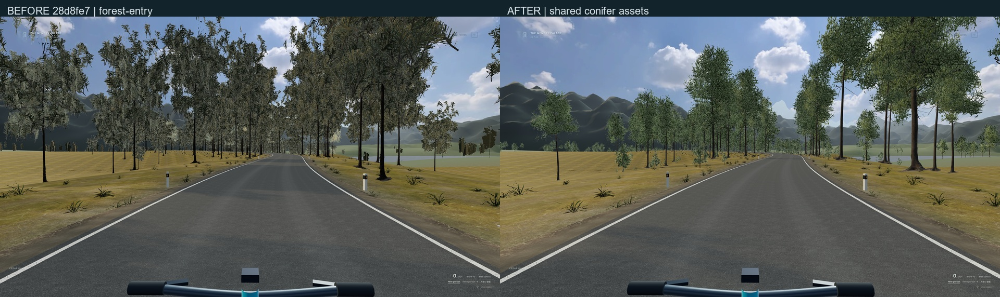
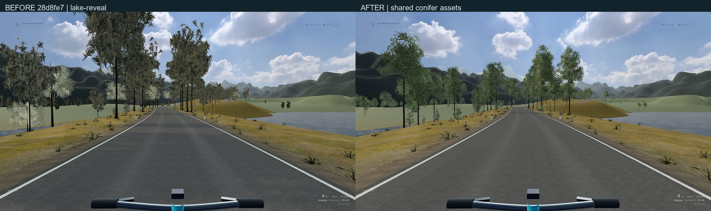
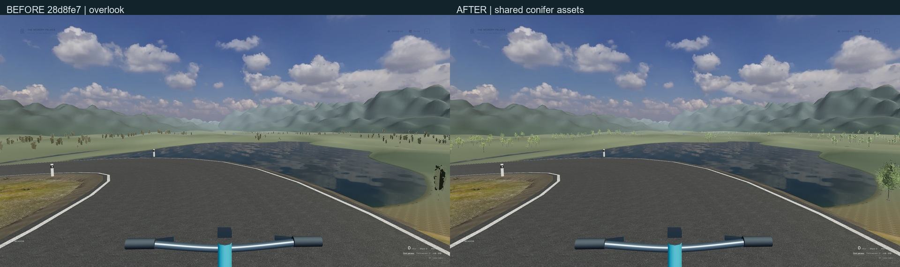
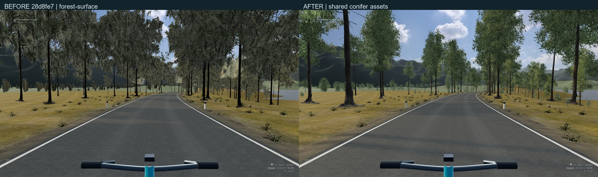
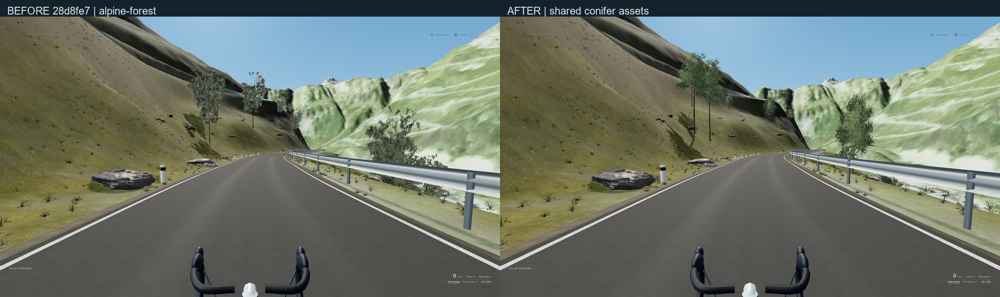
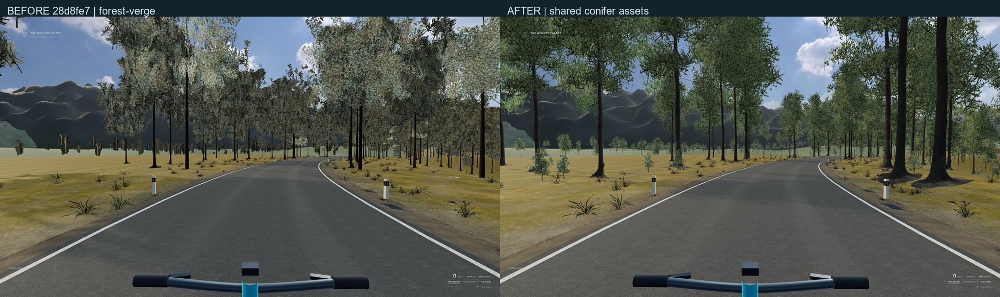

# 骑行植被阶段：来源、画面与验收

基线为稳定草稿 [PR #27](https://github.com/YNS34-hub/YNS34-hub.github.io/pull/27) 的 `28d8fe7088ab3492d4c49dccc9e5742e60626486`，分支 `codex/memory-palace-forest-canopy-quality`。资产提交 `b6db61a`，实际渲染提交 `efb9396`。旧分支 / PR 和主站入口保留，没有 reset、force push、自动合并或部署。

**本段验收范围是植被，原两份指令的整体写实质量仍未全部完成。** 地表过渡、山体单色与包络、湖面 / 湖岸、人物相较动捕与面扫的差距仍明确保留，不能用本段通过替代原总验收。

## 实际修改

- 由两个完整来源的冷杉形态和三个幼苗形态组成共享资源。原始木质几何、完整来源枝叶分布、真实针叶照片和正确 alpha 进入实际渲染路径；不是继续使用生成的灰叶纹理或交叉远树平面。
- 每棵树分近、中、远三档，带距离回差，分桶每半秒更新。共享几何 / 采样器，没有逐帧 React 全局更新；距离使用相机世界坐标转换到根节点本地。近中档使用原有唯一太阳阴影；中远处取消不可辨微法线采样。
- 保留分块 / 六段资源上限和原公路、湖岸、林线、坡度、退距限制。高山地图共享这套树木资源，地形 / 路线 / 物理 / 天气设置不变。新植株位置不依赖画质所消耗的枝叶随机数。
- 根部不漂浮：森林近树使用原渲染路侧三角面，远树使用原远地表三角面；源幼苗叶簇按比例缩小防穿地，不抬高整株、不拉伸照片。流式实例释放自己的矩阵缓冲，共享几何、材质和源解码图像不会由单一路段销毁。
- 原有安静风感与减少动态保留，不引入第二套骑行、导航、音乐或状态系统。

许可与转换细节见 [素材来源](../../public/media/road/forest/SOURCES.md)。这些是 **CC0 模型和照片的有预算衍生版**，不是面向浏览器输出原始百万针叶模型，也不冒称全树扫描。六张照片可由 `scripts/prepare-forest-textures.py` 在 Python 3 / Pillow 下逐字节重现；已在捆绑运行时验证。大模型来源范围留在本机，不提交。几何转换使用既有 meshoptimizer。

## 同机位画面

1920×1080 / 2560×1440，medium，Windows 可见 Edge `148.0.3967.70` / NVIDIA GTX 1650 / D3D11。通过 `git archive` 单独导出准确基线；关键源码经 CRLF→LF 规范化逐字节比对，临时 `5193` 独立运行，没有切换正在使用的分支。保存路线距离和观看方向相同；相机位置、四元数误差小于 `1e-6`，实际 DPR / framebuffer 尺寸相等。

| 场景 / 窗口 | 实际 framebuffer |
| --- | --- |
| 森林 1920×1080 | 2400×1350，DPR 1.25 |
| 高山 1920×1080 | 2880×1620，DPR 1.5 |
| 森林 2560×1440 | 2560×1440，DPR 1 |
| 高山 2560×1440 | 3265×1837，受原像素预算上限约束 |

原始截图和逐帧摄像机数据保留于本机 `qa-artifacts/forest-canopy`；公开证据均使用空私人清单、普通公开人物。截图阶段为 `28d8fe7` 加本轮未提交修改，原始报告保留 `dirty:true`，不把它伪标为提交后的拍摄。静态实际代码随后保存为上述两个提交；完整原生骑行报告来自 `efb9396`。减少动态只冻结原环境时钟，未注入速度 / 计分。

六张对比均已逐张实际查看，左为基线，右为本轮。

初次直接 Prune 不连通针叶导致树冠消失，已拒绝；后续稀碎枝簇也未接受。初期幼苗最低 -6.9 cm 被接地检查查出并修复。失败图留在本机 `after-initial` / `after-clusters`，不拿失败候选作为最终图。

## 测试与性能

- TypeScript、lint、42 文件 / **230 单元测试**、`build:public` 通过。新增测试覆盖几何接地 / 真实覆盖面积 / 三档预算、LOD 回差、实例释放不销毁共享资源。原源摘要和路由保护未替换为新摘要。
- 1920 / 2560 公开生产版 **8 条原生流程**通过：5 / Enter、步行 / 上下车、C 骑姿、视角、照片 / ESC、返回。未使用生产 debug API 或注入模拟状态。
- 原馆 **12 项回归**通过：主要房间 / Memory Reveal、v1 IndexedDB、指定展厅批量导入与刷新、收藏、唯一网页预览、Cinema 原位 / ESC / 后退、回廊状态门、碰撞与退出、实际本地音频频段与暂停、房间配乐恢复、非 3D 入口。隔离测试上下文屏蔽私人清单与头像，未覆盖用户的浏览器数据。
- 两地图真实完整行程：森林 **3529.720 m / 390.440 s**，高山 **10156.693 m / 701.512 s**，均结束并返回。坐 / 站循环、六段流式上限、无 NaN / 停滞、2.5 cm 手脚接触断言保留；左鞋底采样峰值约 6.014 / 5.834 mm。此项为无头浏览器功能证据，**不是显卡 FPS 成绩**。
- 公开私人目录只有空 `manifest.json` 与空 `avatar.json`。原代码合成的 `palace-study.wav` 经与基线 blob 逐字节核对后保留；商业音频、私人 LRC、HTML / 清单 / 浏览器导入均未加入公开构建。本机 4 壁纸 / 22 图像 / 40 音频 / 8 项目与私人头像已恢复注册，`dist` 保持干净。

以下为**可见本机 Edge / GTX1650 的独立短测量**。没有截图 / 录像 / 构建并发；排除重复 RAF，`hidden` / `unfocused` 均为 0。静态窗口 8 秒，W 骑行 20 秒；两端同一起始距离。使用公开人物、medium 和上述实际 DPR，减少动态摄影 fixture。不是全程或热稳定测量。

| 1920×1080，实际渲染帧 / 秒 | 基线 | 本轮 |
| --- | ---: | ---: |
| 森林入口 | 83.7 | 76.9 |
| 湖景路段 | 109.4 | 95.1 |
| 远眺 | 115.7 | 99.2 |
| 近树路段 | 75.0 | 66.6 |
| 实际 W 骑行 | 78.1 | 70.9 |
| 高山林线 | 72.8 | 72.2 |

W 骑行 p95 由约 14.3 ms 增至 20.9 ms；单次最长帧约 166.4 / 138.9 ms。森林主 pass calls 从 61–107 到 70–149，三角形约 0.33–1.95 M 到 1.21–1.96 M；活动灯均为 2、阴影灯 1。按可见材质 RGBA8 / mip 唯一源及采样器估算为 164.8 / 187.2 MiB，**不含 HDR / framebuffer / bone textures，不能当总 VRAM**。树冠 / 阴影质量有额外开销，没有用模糊画面或虚报 FPS 掩盖。

原始数值、功能报告、公开隔离、测试 / 构建日志见 [evidence](evidence)。未测：全路线帧时间、热稳定、4K、最终植被 high 档的独立 FPS；不把设置 UI 数字或无头渲染器当硬件成绩。

## 当前入口与后续

[森林](http://127.0.0.1:5190/cycling?view=third) / [高山](http://127.0.0.1:5190/alpine-ride?view=third) 使用本机素材；`5191` 为公开生产预览。地址需要本机服务，本段未部署 GitHub Pages。原 `5190` / `5191` 服务保持运行。

下一阶段从仍未达标的山体 / 地表开始：当前森林 mountain 分支提前返回单色材质，后面的照片 shader 没有实际执行；近远土壤边界、大片平地与有限天空湖面仍需修正。保留原地形物理、路线和停靠点，不用加房间、滤镜或随机摆件替代质量提升。
