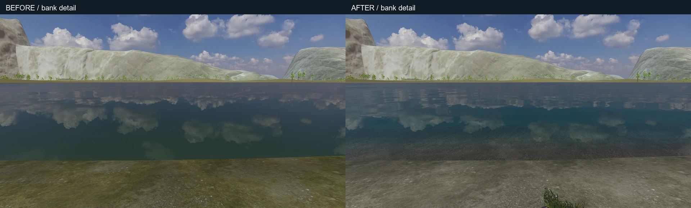

# 湖面、湖岸与过渡带 / 2026-10-16

本轮在现有森林骑行地图上完成湖面和岸线的本地渲染验收。原项目为 `codex/memory-palace-terrain-material-quality`，HEAD `6f345d86f9abf7a79963799be5e37669912d13b5`；隔离工作区为 `codex/memory-palace-lake-shore-quality`。隔离副本带入开始时的未提交地形和前轮篮球代码。本轮只交接下述湖泊相关增量，不把其他工作算作本轮成果。

只读核对：PR [#28](https://github.com/YNS34-hub/YNS34-hub.github.io/pull/28) 与 [#23](https://github.com/YNS34-hub/YNS34-hub.github.io/pull/23) 都仍为开放草稿；本轮没有新建、更新、合并 PR，没有推送或公网部署。

## 改动与边界

- 水面直接裁剪已有谷底三角形，保留同一平面的水深插值。水面由 **24,391** 减至 **1,081** 三角形；旧版独立网格造成的岸线最大约 **0.1183 m**、三角形内部水深约 **0.2015 m** 误差已复现，新版逐顶点/三角形回归通过 **0.0002 m** 门限。这个精度针对共享谷底；路侧既有地表覆盖层继续用实际深度测试交会。
- 浅水复用已有岩石照片表现湖床，按水深与视线长度进行吸收；细波按屏幕尺寸衰减，浅水更平静。保持不透明、深度写入和固定水位，避免透明排序和顶点波动撕开岸线。
- 近路堤和远地表共享按真实水位计算的矿物色、湿土和干地过渡。岸草/石沿实际坡度上岸，保留固定生态分布和原数量上限。
- 复用原天空和现有岩石纹理；没有新纹理下载、反射相机、渲染目标、灯或后处理。只有天空反射，仍没有山体/树木/人物倒影；湖床为深度着色，不是屏幕折射。
- 补上现有地形接入缺少的地理元数据预加载，只预取原来已用的一份 JSON。没有顺带加载高山 DEM 或整套高山纹理。
- 路线、地形高度函数、远山几何/影像映射、控制、存档和私人媒体数据保持原实现。远山观感仍属于原先未验收的地形任务。

## 实际画面

可见 Edge **148.0.3967.70**，GTX 1650 / ANGLE D3D11，中画质。五个既有有效存档位置，经原生步行接近/上车，再进入照片模式布置朝向。静态照片不冒充连续骑行；前后位置差小于 0.0001 m、四元数点积误差小于 0.000001，FOV 相同。

1920×1080、2560×1440 各五张已检查：[全部视角](evidence/all-views.webp)。1440p 只验收画面，没有性能结论。以下对照只缩放和加标签，没有调色或生成补画。

| 视角 | 对照 | 最终 1080p | 最终 1440p |
| --- | --- | --- | --- |
| 湖面揭示 / 18.5% | [前后](evidence/compare-lake-reveal.webp) | [图](evidence/1920-lake-reveal.webp) | [图](evidence/2560-lake-reveal.webp) |
| 湖岸公路 / 23.3% | [前后](evidence/compare-shore-road.webp) | [图](evidence/1920-shore-road.webp) | [图](evidence/2560-shore-road.webp) |
| 高处俯瞰 / 48.7% | [前后](evidence/compare-overlook.webp) | [图](evidence/1920-overlook.webp) | [图](evidence/2560-overlook.webp) |
| 水线 / 70% | [前后](evidence/compare-waterline.webp) | [图](evidence/1920-waterline.webp) | [图](evidence/2560-waterline.webp) |
| 回望湖谷 / 83% | [前后](evidence/compare-last-light.webp) | [图](evidence/1920-last-light.webp) | [图](evidence/2560-last-light.webp) |

另有同机位[近岸细节前后对照](evidence/compare-bank-detail.webp)。该图以同一地表水位交点生成一次诊断摄影相机，直接在原画布渲染，不移动玩家；不代表原生步行抵达，不是新增的运行时相机。

## 性能与原生行程

1920×1080 视口，实际绘制 **2400×1350 / DPR 1.25**。每处热身后静止采样 8 秒，记录实际渲染帧，窗口均可见且有焦点。前后调用数和纹理数在同机位均不增加，主通道三角形均减少 **19,834**。

| 视角 | 修改前 FPS | 修改后 FPS | 修改后 P95 | 修改后最大帧间隔 |
| --- | ---: | ---: | ---: | ---: |
| 湖面揭示 | 75.0 | 81.3 | 14.0 ms | 83.2 ms |
| 湖岸公路 | 82.9 | 74.3 | 20.9 ms | 97.7 ms |
| 高处俯瞰 | 82.5 | 83.1 | 14.0 ms | 69.6 ms |
| 水线 | 77.9 | 76.0 | 20.8 ms | 76.5 ms |
| 回望湖谷 | 71.1 | 81.3 | 14.1 ms | 69.5 ms |

这些是同机位短样本，存在系统负载波动，不据此宣称固定百分比提速。不是 GPU 计时、全路线最低帧率或热稳态测试。renderer.info 仅为主通道诊断，不等于全机 VRAM/全部阴影成本。

从 69% 有效存档开始，真实键盘连续踩踏 20 秒：**70.9 FPS、P95 20.9 ms、最大 138.8 ms**；峰值 **147 calls / 1,444,792 triangles / 49 textures**。仍存在移动分区偶发停顿，不宣称已经消除。

[原生行程 7 项通过](evidence/native-journey.json)：步行接近与上车、真实踩踏/分区交接、制动及实际 PNG 保存、水波在减少动态下冻结/恢复、照片 ESC 与第一/第三视角、刷新后恢复进度并回到步行、返回原博物馆。页面错误、上传和外部请求均为空。

原始采样与源文件校验：[渲染报告](evidence/render-validation.json)、[同机位比较](evidence/comparison.json)。原始 PNG、全部失败报告和本机完整日志保留在 `qa-artifacts/lake-shore/`。

## 源码检查与保护

最终 **46 个测试文件 / 331 项测试**、lint、脚本语法、TypeScript 和公开生产构建通过。新增几何回归先在原实现上失败，再通过新版；原保护摘要和地形适配清单没有被重置，新湖岸改动通过独立适配清单逐段撤销后继续检查旧摘要。

空私人素材的生产版仅在 `127.0.0.1:5197` 启动，原 `check-road-cycling.mjs` 的 **7 项真实操作**通过，错误列表为空，包括进馆/接近上车、实际踩踏与惯性、换挡制动、照片下载、Guide/音乐面板层级、刷新与返回。

限定 **12 个源码/测试/脚本文件**及本目录证据已接回原 `5190`。接回前后逐字节检查，原分支和 HEAD 未变，另外 **1,097** 个受保护文件与四份私人媒体标记校验值均未变。原项目的 TypeScript、**9 项**针对性回归，以及湖面揭示/俯瞰/近岸的浏览器复检通过；[接回后渲染记录](evidence/integrated-validation.json)错误、上传与外部请求均为空。原始字节备份和可按 CRLF 工作副本应用的限定补丁保留在本地交付记录。

人工源码审查检查了裁剪绕序、深度插值、预算、共享纹理所有权、减少动态和卸载。湖面几何与材质各自释放，借用纹理由原场景管理。真实 GPU 首轮检出了 GLSL 保留字错误，修复后最终两种分辨率 10 张主视角及 2 张细节图均无页面/编译/GL 错误。

修改前冷加载报告保留了现有地理元数据读取触发的 React 警告，因而报告为失败；其中同机位静态图和短采样仍明确标注为基线数据。预加载修复后的最终渲染和原生行程错误列表为空，没有从日志中过滤这条警告。

本轮公开构建仅在隔离目录执行：五类私人清单均为空，人物 profile 为 null，无私人头像、音频、歌词、HTML 或 collection。原项目的私人注册清单和素材没有重新生成，也没有复制进隔离副本。交接前检查原始 1,105 个文件和四份私人媒体标记；限定文件的原始字节备份、增量补丁和最终逐文件校验见当前聊天的本地交付记录。

复查命令：`node scripts/capture-lake-shore.mjs`（可用 `PALACE_URL` 指向本机预览）、`node scripts/check-lake-shore.mjs`、`npm test -- --maxWorkers=1`、`npm run lint`、`npm run build:public`。原生脚本只允许 localhost/127.0.0.1。公开构建应在这个空私人素材的隔离目录复查。
