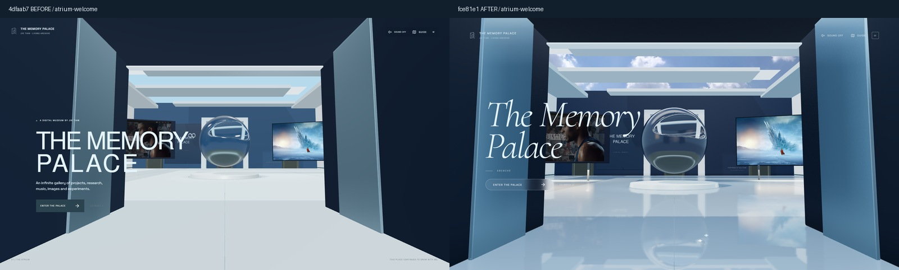
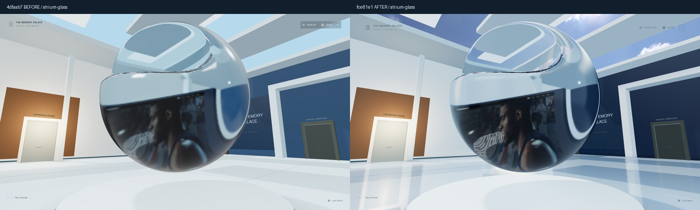
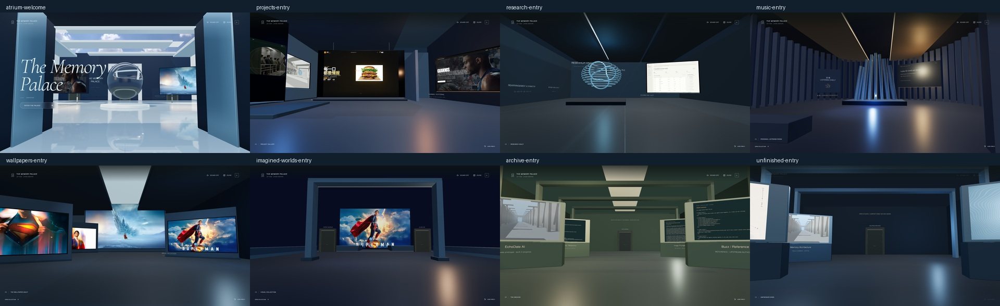

# 馆入口：字体、真实光学与验证

基线：PR #25，`4dfaab7044b71286afa6a15cb959949cfdf6271c`。独立分支 `codex/memory-palace-museum-entry`，没有修改主站发布方式或合并旧 PR。

## 实际修改

- 展览标题使用开放许可 Cormorant Garamond 300 italic，界面 Manrope，元数据 JetBrains Mono。四个 CSS 文件集中定义颜色、字体、界面与入场；原馆标、原生按钮、焦点锁、ESC 和事件处理保留。标题按附件原文为两行。
- 中庭保留原闭合 GLB、门洞与尺度，使用已有公开天空照片和 HDR 构建玻璃可反射的光场。玻璃只修改自有材质副本。
- 修正旧地面被基底遮住的问题。中庭仅一处真实平面反射：中等 512² / 高等 768²，最多 8 / 12 Hz，静止减少动态模式不持续重画；低画质无反射目标。反射由正确镜像与裁切产生，图像未作为假地面反射粘贴。
- 展屏脚架与碰撞共用坐标；原核心和中庭主通路保持。两秒入场只在未开始参观时工作，随后恢复原 60° 镜头。
- 手机验证发现隐藏 GUIDE 文字后按钮无可访问名称，已补 `aria-label` 并重跑生产版。

## 真实画面

截图为安装版 Edge 148 / D3D11 / NVIDIA GTX 1650，桌面 1920×1080 与 2560×1440，中等画质，DPR 1，空私人清单与中性角色。静态截图使用无头 Edge，**不用于性能成绩**。同机位中景、近景与侧景相机和 60° FOV 相同；入口镜头由 60° 改为 48°，这是构图变化，不称为相同镜头。减少动态开启，收藏与灯光状态一致。

还有 `atrium-entry-comparison.jpg`、`atrium-glass-side-comparison.jpg`、`entry-1920.jpg`、`entry-2560.jpg`。原始截图和每幅实际相机参数留在忽略的 `qa-artifacts/museum-entry`；`views.json` 保存参数。没有使用 README 旧图或用户参考 PNG 充当实际画面。

## 已运行验证

- 类型检查、lint：通过；39 文件 / 214 单元测试通过。
- `check-quality-leap.mjs`：12 项回归通过，覆盖主房间 / 返回 / WASD、真实收藏显影、指定肖像导入与刷新、Cinema 精确返回、弹窗阻止移动、单一网页预览、收藏更新、五段回廊、边界、真实音频 FFT 与暂停、配乐恢复和非 3D Cinema 返回。
- `check-museum-entry.mjs`：低画质无反射目标、原核心保留；减少动态入场恢复 60°；GUIDE / 单次 ESC；1920×1080 与 390×844 **生产版**字体、入场、导航、无横向溢出、非 3D 入口通过。
- public build 通过；五组私人清单为空，未包含商业音频、LRC、私人 HTML / collection。原 `/`、`/museum/`、`/legacy/` 与骑行入口保留。公开 QA 后重新注册本地素材，构建输出仍保持公开隔离。
- 手工审查材质 / 纹理 / 目标生命周期：专属资源自行释放，共享 GLTF、HDR、照片缓存不由局部组件销毁；原固定保存摘要仍校验，仅逐段反向撤销明确授权的中庭局部 diff。

## 可见硬件采样

与截图、录屏分开运行 `measure-quality-leap.mjs`。本机可见 Edge 148，GTX 1650 / D3D11，1920×1080，中等画质，DPR 1，正常动态开启。

| 样本 | 时长 | 平均 FPS | P95 帧时间 | 最慢帧 |
| --- | --- | --- | --- | --- |
| 中庭静止 | 5.01 s | 82.4 | 20.8 ms | 41.7 ms |
| 中庭行走 | 7.00 s | 84.4 | 20.7 ms | 48.5 ms |

峰值 265 draw calls / 67,368 triangles / 48 textures / 8 灯；场景材质贴图估算约 80.8 MiB，含 mipmap，不包含所有渲染目标、驱动或 GPU 总显存。数据是浏览器 RAF 墙钟采样，含采样开销，不是 GPU timer query，也不是长时稳定性结论。没有完成 1440p 高画质长时性能测量。

## 限制与预览

仍未达到用户参考静帧的间接光、光线追踪与人物扫描资产质量；没有把实时网页宣称成离线渲染。保留原核心而不是生成替代雕塑，玻璃近景依然能看到实时折射采样的分辨率限制。

本地开发 `http://127.0.0.1:5190/`；已更新公开构建预览 `http://127.0.0.1:5191/`。未部署到 GitHub Pages 主站。
