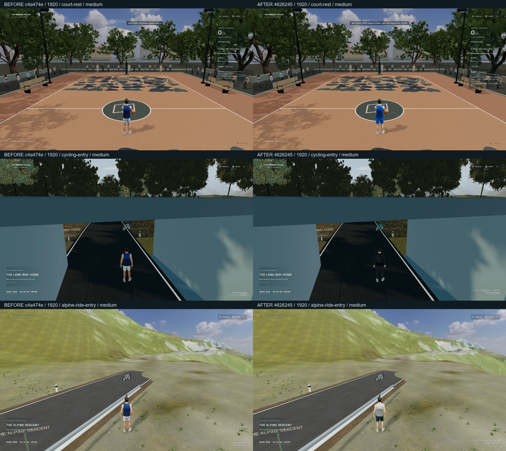
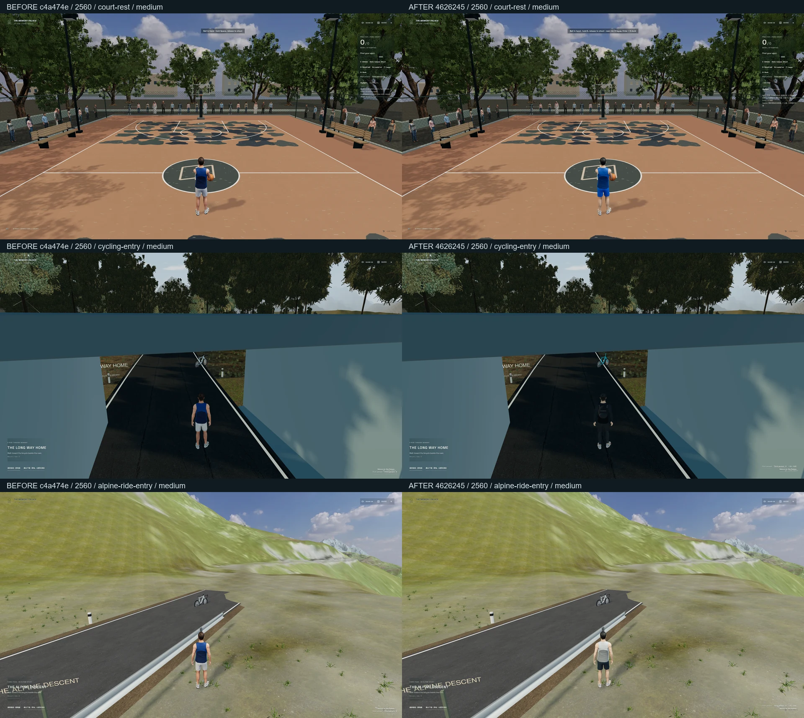
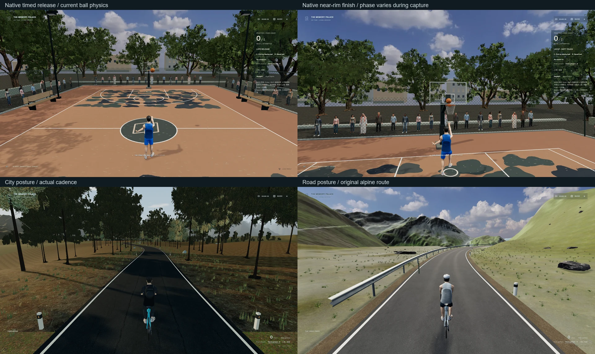
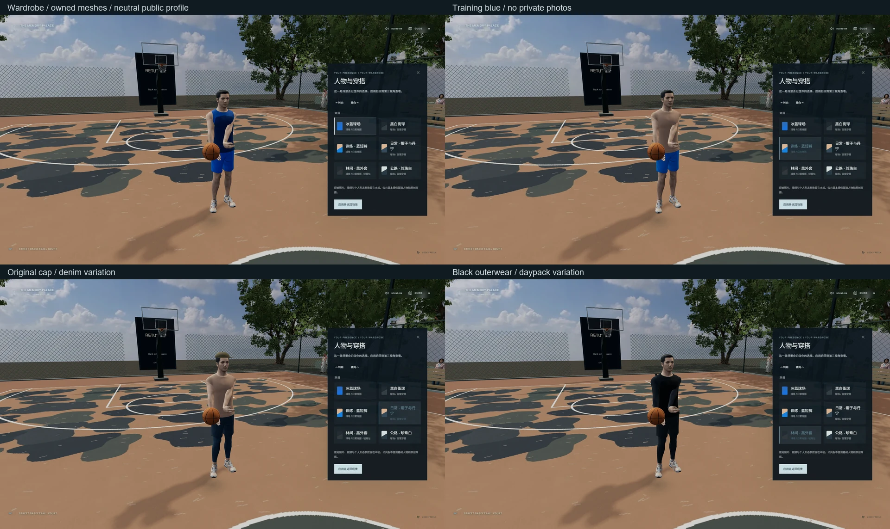

# 人物、个人按键与运动动作

基线为准确的 `c4a474e354d1220ceb070870f2afabc80c8599e2` / 草稿 PR #21；独立分支 `codex/memory-palace-personal-athlete`。本轮改变人物呈现和动作衔接，保留球场、两张骑行地图、原物理计分、音频 / 歌词、媒体库与返回链路。

## 入口和操作

本机预览：[篮球](http://127.0.0.1:5190/basketball?view=third)、[森林骑行](http://127.0.0.1:5190/cycling?view=third)、[高山骑行](http://127.0.0.1:5190/alpine-ride?view=third)。这些地址需要本机服务；没有部署 GitHub Pages。`5191` 为本机的干净公开生产版。

| 操作 | 结果 |
| --- | --- |
| `5` / `Numpad5` 按住后松开 | 远处沿原蓄力 / 松键流程投篮 |
| 持球、面向篮筐、3.4 m 内按 `5` | 收球、两步、单脚起跳上篮 |
| `Enter` / `NumpadEnter` + `W` 助跑，2.8 m 内按 `5` | 实际跑速达到 2.2 m/s 后扣篮；站在篮板后方或背向篮筐不接受 |
| `Shift`、`Space`、`F`、`G`、原鼠标操作 | 继续保留加速、投篮、上篮与扣篮旧操作 |
| `V` / 视角按钮 | 现有第一 / 第三人称切换和每图偏好保存 |
| 人物 / 穿搭 | 原 settings 对话层暂停控制；转动预览、六套穿搭、按地图保存；ESC 返回 |
| 骑行的 `W`、`S` / `Space`、`Q/E`、`P` | 保留踩踏、刹车、换挡、照片；舒适模式、下车和返回沿原链路 |

`Enter + 5` 不是无条件得分。系统只负责动作与释放点，球继续由原 `BallPhysics` 处理，实际向下穿过篮圈才计分。近篮提示读取同一条件，不提供第二套计分器或音频引擎。

## 具体修改

- `src/worlds/court/controls.ts`、`finishing.ts`、`BasketballCourt.tsx`、`src/world/Player.tsx`：用户习惯的按键、条件化动作、真实运球收球点、长第一步 / 短支撑步、抬膝、起跳、释放、落地恢复。首次收球不会跳到胸前；暂停不推进动作时间，球只释放一次。
- `src/worlds/presence/Avatar.tsx`、`shotPose.ts`：保留原授权骨骼 / 走跑混合，在其上加手脚 IK、投篮下蹲与随球抬手、辅助手撤离、腕部跟随及落地收势。真实速度决定走跑朝向；跳投 / 近篮动作不继续播跑步腿部循环。
- `appearanceRig.ts`、`avatarProfile.mjs`：有限外形参数、黑短发 / 肤色、六套原创配色及帽子 / 轻背包；克隆几何和材质，保留共享原纹理。形变用原平滑法线的雅可比变换，避免拆分 UV 网格重算法线导致面片。外套衣袖按原骨骼权重覆盖肩 / 上臂 / 前臂，保持手指肤色。
- `appearance.ts`、`Wardrobe.tsx`、`Controls.tsx`、`CameraRig.tsx`、`src/ui/Settings.tsx`：独立本机外观存储键、暂停门控内换装、预览只转渲染镜头。没有迁移或清除现有 IndexedDB。修复新增按钮拦住原返回按钮的实际回归；仅按钮本身接收点击。
- `riderPose.ts`、`src/worlds/road/RoadBike.tsx`、`Experience.tsx`：依据用户 43.7 秒骑行视频加入更直立的休闲姿态、匹配的高直把 / 蓝车漆与背包；公路穿搭保留原弯把。手握点与实际转向枢轴一致，脚仍追随真实曲柄相位；微小髋部 / 脚踝反应只来自实际踏频，停踏与舒适模式会收敛。
- `scripts/register-personal-avatar.mjs`：个人参数和可选本机头部 atlas 是独立注册适配，公开构建不读取它们。文件必须为受限、常规非符号链接；参数白名单、大小上限、PNG 类型与尺寸检查，前端只接受固定本机 atlas 路径。

参考了 [官方 2K27 对收球、终结和节奏控制的说明](https://newsroom.2k.com/news/nbar-2k27-gameplay-unleashes-complete-on-court-control-in-a-balanced-two-way-era)，并实际观看用户提供的 [街头 1V1 视频](https://www.bilibili.com/video/BV1P8tH6gEMM/) 局部片段。这里采用原创阶段动作与原骨骼约束，没有复制游戏资产、Logo、动作库或专有 ProPLAY 系统。`5 / Enter` 是用户指定的习惯，不声称为官方统一键位。

## 个人素材与公开版本

参考照片、视频、个人参数和头部 atlas 都留在本机。`personal-media/avatar/profile.json` 可给出受限外形参数，`head-color.png` 可提供同一网格的平方 PNG atlas。文件与生成结果都被忽略；`build:public` 输出 `{ "profile": null }` 并移除其生成的私有 atlas。公开版本包含授权基础人物与原创穿搭。

本机 atlas 使用内置 imagegen，根据三张用户照片编辑原授权 UV atlas。精确保持 UV 位置、眼孔与口腔岛是生成约束；结果已在实际人物上查看。完整提示词和源输出只保存在忽略的 QA / 个人素材目录，未随 Git 推送。脸部被手机遮挡的部分是保守近似，身形数值是艺术调整，不是实际人体测量。来源与 MIT 许可见 [SOURCES.md](../../public/media/presence/SOURCES.md)。

## 实际画面

BEFORE 是 `git archive` 提取的准确 `c4a474e`，AFTER 为本轮最终运行代码。统一可见 Edge、medium、DPR 1、相同内容与日照、1920×1080 / 2560×1440。静止身体眼位与四元数夹角经过验证；场景图像只等比缩小，标签加在画面外。






动态截图用于记录实际键盘流程，拍摄时动作继续推进，不能把文件名中的 steps / rise / takeoff 当作精确阶段或声称同一毫秒对照。原尺寸截图、短录屏、失败轮及逐帧状态保存在忽略的 `qa-artifacts/personal-athlete/`；个人形象截图没有进入公开证据。两种分辨率的静止对照与动作 / 换装拼图均实际查看。

## 验证和边界

最终结果与性能记录见 [results.json](results.json)。检查包括 TypeScript、lint、182 项单元测试 / 33 文件、两种分辨率的原生新键 / 换装 / 骑行、旧操作和 Cinema 返回、公开生产版及私人资源扫描。保留检查继续使用 `6380557` 的原摘要和明确适配，没有更新旧摘要掩盖变化。公开版无开发调试接口与上传请求。

最终运行代码为 `462624507aa0a63a3965db97df0bd967cfbe3119`。原生新操作验收共 12 组检查、42 张公开基础人物截图；公开生产版 8 组检查、原生产流程 5 组、旧第三人称 / Cinema 流程 3 组均通过。另有 6 组本机个人形象检查与 21 张本机截图，不进入公开证据。测试时尚未提交的是 QA / 文档文件，没有额外运行代码修改；报告保留当时的 dirty 标记。

复验命令（先启动开发 `5190`、公开构建预览 `5191`；性能还需要准确 `c4a474e` 的 `5193`）：

```powershell
npm test -- --maxWorkers=2
npx tsc -b
npm run lint
$env:PALACE_ARTIFACTS='qa-artifacts/personal-athlete/after-final'
node scripts/check-personal-athlete.mjs
npm run build:public
$env:PALACE_HEADED='1'
$env:PALACE_PERSONAL_CONTROLS='1'
node scripts/check-third-person-public.mjs
node scripts/check-worlds-production.mjs
node scripts/check-alpine-public.mjs
node scripts/measure-personal-athlete.mjs
```

不要在骑行、截图或测量时重建 / 注册素材，也不要并行跑 GPU 测试。完成公开验证后可运行 `npm run media:register` 恢复本机开发素材；`dist` 仍保留干净公开版。

具体限制：角色是原授权网格的艺术化调整，尚不是照片扫描或完整面部 / 身体建模；穿搭基于同一基础轮廓，没有布料模拟和高精度缝线。动作比旧阶段划分更完整，仍为程序约束，尚无职业球员动作捕捉、复杂左右手终结库或对手 AI。未加入视频中的松把动作。未重新验收完整长路线、1440p 长时帧率、移动端或所有显卡；不能把短采样说成全程稳定帧率。

## 目标显卡短采样

2026-10-12（Asia/Shanghai），可见 Edge `148.0.3967.70`、真实 NVIDIA GeForce GTX 1650 / ANGLE D3D11，1920×1080、medium、DPR 1。同一机器分别运行准确基线与本轮代码，骑行动力来自实际键盘踩踏，未注入速度；使用空私人目录与公开基础人物。除测试窗口遮挡检测外沿用 Playwright 默认浏览器参数，所有样本无隐藏 / 失焦记录。

| 场景 | 基线 FPS | 本轮 FPS | 本轮 p95 帧时 ms | 本轮最长帧 ms | 主通道 calls | 主通道三角形 | 活动光 / 阴影光 | 材质贴图估计 MiB |
| --- | ---: | ---: | ---: | ---: | ---: | ---: | ---: | ---: |
| 球场白天 | 136.9 | 137.7 | 7.2 | 34.8 | 118 | 1,138,283 | 2 / 1 | 242.5 |
| 球场夜间 | 129.6 | 130.2 | 13.9 | 152.7 | 118 | 1,138,283 | 3 / 1 | 242.5 |
| 森林骑行静止 | 121.1 | 104.7 | 14.0 | 48.6 | 147 | 2,223,432 | 2 / 1 | 56.8 |
| 森林骑行踩踏 | 120.2 | 111.2 | 14.0 | 48.6 | 147 | 2,223,432 | 2 / 1 | 56.8 |
| 高山骑行静止 | 120.4 | 113.4 | 14.0 | 76.5 | 184 | 2,256,900 | 2 / 1 | 182.1 |
| 高山骑行踩踏 | 123.8 | 117.7 | 13.9 | 69.4 | 189 | 2,311,692 | 2 / 1 | 182.1 |

球场平均余量保留；两图骑行在这些样本中比基线低约 5–14%，因此不声称全场景性能持平。夜间最长帧从基线的 103.9 ms 增至 152.7 ms，短时间卡顿仍存在，单次采样不能归因或代表长期频率。球场着色程序数由 156 / 183 增至 164 / 192；没有增加活动光或实时反射通道。森林 draw calls 从 153 降至 147，减少调用并不等于必然提高实际帧率。

每个状态仅采样 5–7 秒，帧率按真正新增的渲染帧 / 墙钟时长计算，排除重复 RAF。表中调用 / 三角形是主通道峰值，贴图数字是材质引用的估算，不是完整 GPU VRAM 或所有通道统计。没有完成当前版本的完整路线长跑、热稳定性、1440p 长时间、私人头部贴图独立性能测试。较早一次采样与证据图片编码部分重叠，已在 results 中保留并明确标记，采用最后一次无其他 QA / 构建 / 编码干扰的采样作比较。

## 原子代码提交

| 提交 | 改动 |
| --- | --- |
| `fff989b` | 5 / Enter 按键与连续分阶段终结动作 |
| `e696b3e` | 本机人物变体、六套穿搭、休闲骑姿 |
| `7a5c96f` | 第一轮肩部接缝修正与私有 atlas 说明 |
| `4626245` | 实际截图发现第一轮覆盖不足后，按原骨骼权重完成连续衣袖 |
| `4788ea0` | 原生按键 / 换装回归、真实硬件帧采样与公开截图打包脚本 |

QA 脚本与公开证据分别提交。父分支 PR #21 保持原状态；没有自动合并或变更主站入口。

## 后续队列

按用户要求，当前人物 / 动作一轮收尾后，再处理两份纯美术指令：

1. **AAA ENVIRONMENT ART PASS**：光照 / 天空 / 大气 → 道路 → 生态植被 → 地形层次 → 湖泊与三个英雄视点 → 最终画面；保留物理、路线、停靠、照片、返回，不增加新地图、玩法或 UI。
2. **第二刀：ROAD MATERIAL & ROADSIDE REALISM PASS**：独立道路 PBR、老化、边缘破碎、碎石 / 土 / 草过渡和克制路侧细节；不重做路线、景观构图、车辆或交互。

当前截图不代表上述环境或道路两轮验收，不把人物换装当作风景逼真度升级。
