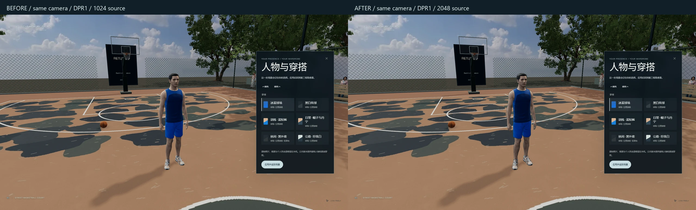
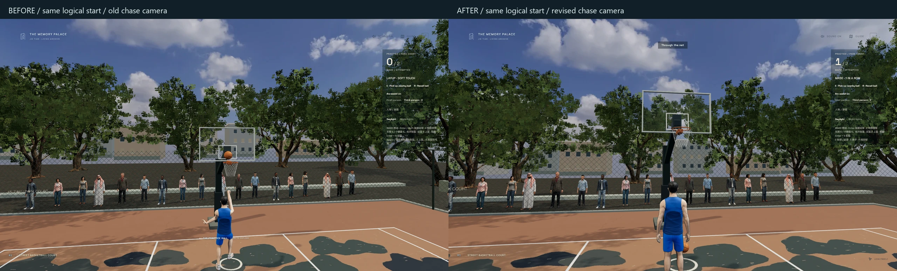
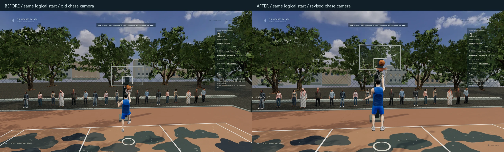

# 篮球与骑行人物、控制和动作验收

从入口草稿 [PR #26](https://github.com/YNS34-hub/YNS34-hub.github.io/pull/26) 的准确提交 `12671dfb211a3059c870dc7d00bf9d5ed6a8b3df` 派生 `codex/memory-palace-sports-detail`。保持旧分支和 PR #22–26；没有 reset、force push、自动合并或更换主站入口。入口改造的独立证据见 [museum-entry](../museum-entry/README.md)。

本轮只调整原人物、运动约束、球动作和控制，保留地图、路线、球物理计分、原馆、播放器 / FFT / 歌词、导入、收藏、存档、第一人称和 Cinema 返回。

## 预览与按键

本机服务：[篮球](http://127.0.0.1:5190/basketball?view=third)、[森林骑行](http://127.0.0.1:5190/cycling?view=third)、[高山骑行](http://127.0.0.1:5190/alpine-ride?view=third)。`5190` 保留私人本机素材，`5191` 为干净公开生产预览。这些地址需要本机服务；本轮没有部署 GitHub Pages。

| 场景 / 输入 | 行为 |
| --- | --- |
| 篮球 `5` / `Numpad5` | 远处按住、松开投篮；持球、面向篮筐、3.4 m 内上篮 |
| 篮球 `Enter` / `NumpadEnter` + `W` | 加速；实际速度达 2.2 m/s、篮筐 2.8 m 内按 `5` 扣篮 |
| 篮球 `Space` / `Shift` | 空格不蓄力、不出手；Shift 为普通移动速度 |
| 篮球 `E` / `X` / `R` | 拾球或切换运球 / 左右换手 / 找回球；原鼠标操作保留 |
| 骑行 `C` 或骑姿按钮 | 坐姿、站姿平滑切换，手和脚沿原把位、真实踏频约束 |
| 骑行 `W`、`Q/E`、`S/Space`、`P` | 踩踏、换挡、刹车、照片；原 Shift 强力踩踏保留 |
| `V` / 人物与穿搭 | 原第一、第三视角和六套穿搭；偏好仍保存在本机 |

按键是用户指定的习惯，未声称为官方 2K 统一预设。UI 控件保留自身的键盘焦点行为；场景操作以场景获得控制为前提。扣篮 / 上篮仍必须由原球物理向下穿框才计分，没有第二个计分器。

## 实现与真实细节

- [controls.ts](../../src/worlds/court/controls.ts)、[BasketballCourt.tsx](../../src/worlds/BasketballCourt.tsx)、[ActivityHud.tsx](../../src/worlds/ActivityHud.tsx)：撤销篮球旧 Space / Shift / F / G 游戏键别名，统一真实按键与提示。左右换手平滑过渡；放球后掌心留在腰旁，球按 9.81 m/s² 下落 / 回弹；触地压缩和反弹声与同一相位对齐。
- [finishing.ts](../../src/worlds/court/finishing.ts)、[shotPose.ts](../../src/worlds/presence/shotPose.ts)、[Avatar.tsx](../../src/worlds/presence/Avatar.tsx)：从当前球位、当前脚位收球，连续 Hermite 前进，支撑脚保持落点，再抬膝 / 起跳 / 释放 / 落地。身体近篮跳跃采用重力轨迹；原球只释放一次。提高投篮持球位置，补掌面、辅助手和腕部衔接。
- [prepare-sport-avatar.py](../../scripts/prepare-sport-avatar.py)、[SOURCES.md](../../public/media/presence/SOURCES.md)：恢复 MIT Microsoft Rocketbox **原始 2048²** 四张贴图，未放大旧 1024²；法线图无损。约 8.5 MB 文件、85.3 MiB 解码含 mipmaps，比旧版增加约 64 MiB。取样克隆保留共享解码图像，卸载不销毁 GLTF 缓存；篮球细轮廓 0.75 px、骑行 1.1 px，无全屏描边通道。
- [clarity.ts](../../src/worlds/presence/clarity.ts)、[math.ts](../../src/worlds/presence/math.ts)：1080p medium 的篮球 / 森林从 DPR1 提升至 1.25，高山保留已接受的 DPR1.5；1440p / 4K 有像素预算。缩短、降低第三人称观看距离，骑行轻微越肩；不改逻辑眼位、碰撞或返回姿态。
- [riderPose.ts](../../src/worlds/presence/riderPose.ts)、[RoadBike.tsx](../../src/worlds/road/RoadBike.tsx)、[Experience.tsx](../../src/worlds/road/Experience.tsx)：保留蓝色直把车与公路车。站姿抬髋并移至曲柄上方，同一实际踏频驱动车 / 人的小幅摇车、脚踝和车轮；停止后不伪造节奏。补交叉辐条、气嘴、车把转向、真实鞋底接触。完整踏圈发现左腿目标超出真实腿长，骨盆基准下降 1.5 cm 修正，没有拉长四肢。
- [balance.ts](../../src/worlds/road/balance.ts)、[physics.ts](../../src/worlds/road/physics.ts)：以速度² × 曲率 / 重力计算压弯，保留原动力 / 路线。舒适模式稳定相机，车和人仍侧倾。刹停时踏频真正归零，Cinema 保留坐 / 站状态与曲柄相位；现有存储键和数据库不变。

实际观看了用户本机 43.7 秒直把蓝车视频的关键帧和所给 [街球视频](https://www.bilibili.com/video/BV1P8tH6gEMM/) 约 1:01–1:08 的局部片段。参考了 [2K25 官方 ProPLAY 说明](https://nba.2k.com/2k25/pt-BR/courtside-report/gameplay/) 中用真实动作与连续过渡组织动画的原则；未把 2K25 说明当成已验证的 2K27 内部实现，未复制游戏动作、模型、Logo 或视频素材。

## 画面证据

[森林站姿](images/cycling-standing.webp) · [森林压弯](images/cycling-corner.webp) · [高山站姿](images/alpine-ride-standing.webp) · [高山车架 / 姿态](images/alpine-ride-bike-detail.webp) · [公开 1440p 骑行](images/public-1440-alpine-ride-standing.webp)

[实际近篮操作录像](clips/native-court.mp4)：原生 5 / Enter 助跑、上篮与扣篮；测试起点通过既有开发返回视图适配，球与动作没有模拟注入，录像不是硬件帧率报告。

[坐 / 站与转弯录像](clips/native-cycling.mp4) · [高山骑姿录像](clips/native-alpine.mp4)。均为本机实际操作裁段，使用公开基础人物，无私人图像或版权歌曲。

普通参观截图采用相同逻辑起点、房间、medium 和窗口尺寸；第三人称观看距离 / 越肩位置是本轮明确修改，不能把这些普通对照称作完全相同的渲染相机。额外静态对照使用原有换装观看机位，双方控制为 1920×1080 / DPR1，实际比较相机位置、旋转、FOV、有效画质和真实贴图尺寸，避免用拉近镜头冒充清晰度。所有公开证据均为授权基础人物，私人照片 / 个人头像不进入此目录。

## 测试与全程骑行

- `npm test -- --maxWorkers=1 --minWorkers=1`：40 文件 / 224 测试通过；最终源代码类型检查、lint 及 `build:public` 通过。
- 原生 1920×1080 与 2560×1440：各 6 项 / 21 帧，六套穿搭、弹窗暂停、5 / Numpad5、物理投篮 / 上篮 / 扣篮和两图骑行。
- 最新动作 / 接触：8 项 / 14 帧，两个 Enter、Space 不出手、Shift 不加速、换手、坐 / 站姿接触、压弯、刹车、舒适镜头、Cinema 曲柄相位误差 < 1e-8、下车 / 返回。
- 最新公开生产包：两种桌面尺寸共 8 条原生流程，无开发状态入口；六套穿搭刷新恢复，C 坐 / 站、V、照片 / ESC 和返回通过。
- 原馆 12 项回归通过：v1 IndexedDB、所有主要房间 / WASD、真实收藏显影、目标房间批量导入 / 刷新、精确 Cinema 返回、单个网页预览、收藏、五段回廊、边界、实际音频 / FFT / 暂停、房间配乐恢复、非 3D 入口。
- 两条完整路线见下文和 [森林报告](results/journey-forest.json) / [高山报告](results/journey-alpine.json)；实际查看静态对照、动作帧、站姿 / 压弯 / 车架及公开 1440p 图。
- 本机照片参考人物另外完成 6 项 / 21 帧原生操作，实际查看头部、穿搭和骑姿；私人截图、录像与头像不公开。

较早并行截图 / 测试时，两项原媒体注册测试触发原有 5 秒 I/O 超时；失败日志留在忽略的 QA 目录。隔离单 worker 后全部通过，没有放宽断言或测试超时。基线导出副本的 tests 意外被 Vitest 扫描后，完整移至专用临时目录，原仓库 tests 未删改，基线 ZIP 保留。

新完整骑行检查比短采样多发现一个踏圈接触问题，已修正。森林约 3.53 km，实际 389.741 秒结束并返回，左鞋底采样峰值 1.393 cm；高山 10,156.693 m，实际 697.028 秒结束并返回，鞋底采样峰值 1.249 cm，右腕峰值 2.482 cm，均保持原 2.5 cm 检查标准。两程交替坐 / 站，实测读取原路线、档位、踏频与有界分块，没有注入距离、速度或相机。高山最初被错误的共用 600 秒验收窗口中止，随后按实际长度改正预算并加入 45 秒无进展检查，从起点完整重跑。两程证据分开保存，不把中止的一程标为通过。

接触数值来自腕骨与定义把位、鞋底锚点的距离，每秒 / 短周期采样；不是逐帧所有鞋面和手指的实体碰撞证明。完整骑行是交互与加载验收，不能充当长时间硬件帧率成绩。

## GTX 1650 实测

2026-10-12（Asia/Shanghai），可见 Edge 148.0.3967.70、NVIDIA GeForce GTX 1650 / ANGLE D3D11，1920×1080、medium、公开基础人物。基线为隔离导出的准确 `12671df`，本轮按各场景实际 DPR 测量。所有测量独立于录屏、截图和构建；真实新增渲染帧 / 墙钟时间，排除重复 RAF，各状态 5–7 秒，隐藏 / 失焦记录为零。

| 场景 | 基线 FPS | 本轮 FPS | 本轮 p95 / 最长帧 ms | 实际 DPR / 绘图像素 | calls / 三角形峰值 | 活动光 / 阴影光 | 材质估计 MiB |
| --- | ---: | ---: | --- | --- | --- | --- | ---: |
| court daylight | 112.0 | 117.3 | 14.0 / 41.7 | 1.25 / 2400×1350 | 112 / 1,140,743 | 2 / 1 | 306.5 |
| court night | 111.1 | 110.1 | 14.1 / 152.8 | 1.25 / 2400×1350 | 112 / 1,140,743 | 3 / 1 | 306.5 |
| cycling still | 100.9 | 89.5 | 14.1 / 55.5 | 1.25 / 2400×1350 | 173 / 1,877,071 | 2 / 1 | 164.8 |
| cycling pedaling | 104.2 | 87.8 | 14.1 / 62.4 | 1.25 / 2400×1350 | 173 / 1,883,471 | 2 / 1 | 164.8 |
| cycling standing pedaling | — | 85.4 | 14.0 / 55.6 | 1.25 / 2400×1350 | 173 / 1,909,371 | 2 / 1 | 164.8 |
| alpine-ride still | 89.8 | 95.3 | 14.0 / 90.0 | 1.50 / 2880×1620 | 197 / 2,318,550 | 2 / 1 | 267.4 |
| alpine-ride pedaling | 87.5 | 95.3 | 14.0 / 69.4 | 1.50 / 2880×1620 | 199 / 2,375,172 | 2 / 1 | 267.4 |
| alpine-ride standing pedaling | — | 92.5 | 14.1 / 55.6 | 1.50 / 2880×1620 | 227 / 2,546,558 | 2 / 1 | 267.4 |

基线六项来自同日首次隔离比较，最终八项为骨盆接触修正后的独立复测（代码 `95ceb42`）。森林实际 DPR 从约 1 提升至 1.25，静止 / 踩踏平均比基线下降约 11% / 16%；保留清晰度并如实报告成本。其他短样本的波动不能证明全程性能提高。原始数据见 [初次同机对照](results/performance-initial-pair.json) 和 [最终复测](results/performance-final.json)。

追加用户要求的 **high + 本机照片参考人物**，同一 GTX 1650、可见 Edge、1920×1080，实际所有场景 DPR1.5 / 2880×1620，八个 5–7 秒样本均无隐藏 / 失焦。报告只记录汇总指标，不含私人图片、参数或清单，见 [高画质本机人物采样](results/performance-high-personal.json)。

| 场景 | 平均 FPS | p95 / 最长帧 ms |
| --- | ---: | --- |
| 球场白天 / 夜间 | 71.2 / 72.0 | 20.8 / 41.8；20.8 / 208.4 |
| 森林静止 / 坐姿踩踏 / 站姿踩踏 | 65.3 / 64.1 / 60.4 | 20.9 / 55.5；20.9 / 55.6；21.0 / 48.8 |
| 高山静止 / 坐姿踩踏 / 站姿踩踏 | 91.9 / 93.3 / 91.3 | 14.1 / 83.4；14.1 / 90.4；14.1 / 69.4 |

夜间高画质样本仍出现一帧 208.4 ms 长帧，不声称全程稳定 60 FPS，也没有以降低人物清晰度掩盖它。high + 私人角色与 medium + 公开角色同时改变两项条件，不能用此表单独推断画质或头像各自的性能成本。

材质贴图估计不是完整 GPU VRAM；calls / 三角形为主通道峰值，不是所有阴影或离屏通道总量。没有进行完整路线的持续可见窗口帧率、热稳定性、1440p 长时 / 4K、其他显卡的硬件验收。未把无头截图、设置里的 FPS 数字或 SwiftShader 当成 GTX 1650 成绩。

## 隐私与具体限制

公开生产包五类私人清单均为空，个人头像配置为空，没有私人歌曲、LRC、HTML 或浏览器导入。公开 QA 后恢复本机 4 壁纸 / 22 图像 / 40 音频 / 8 网站及原个人头像注册；这些素材和清单不随 Git 推送。原 IndexedDB / 播放器 / 歌词恢复和 Cinema 返回沿用既有链路。

这是原骨骼、原走跑动画之上的程序约束与动作衔接，尚未达到 2K 的完整动作捕捉、运动匹配、专用人体 / 手部模型与布料品质。个人头像仍为先前本机照片参考的近似，遮挡部分不是扫描还原；基础人物的 2K 源贴图不等于私人头像也有新增细节。山体航拍与地形精度本轮未重建，较近处的地表和森林重复仍可见。没有安装新引擎，也不把更换引擎名称当成已经提升了这些资产。

## 原子提交

| 提交 | 改动 |
| --- | --- |
| 2a96f2a | sports: retain original 2K athlete texture detail |
| dca272f | sports: refine requested controls and connected athletic motion |
| 004c034 | sports: calibrate contacts and preserve cycling pose across Cinema |
| 2f9b2fe | sports: align control hints and bounce feedback with actual input |
| 7254f86 | fix: settle stopped crank cadence before Cinema return |
| 8b8acce | test: record actual sport drawing resolution in native captures |
| 7e15161 | test: compare sports performance against isolated stable source |
| 0fa884a | test: verify standing controls in clean public builds |
| 2343265 | test: verify complete native seated and standing rides |
| 79a6be3 | fix: fit rider hips to full pedal reach without stretching limbs |
| 63ccd3f | test: derive route budgets from distance and compare fixed optical views |
| 95ceb42 | test: require equal effective quality in optical comparison |
| f74d0ca | test: measure high quality with restored local avatar |
