# 第三人称运动体验

从 `codex/memory-palace-court-fidelity` / `e9a3b43e17e659b5021d00eade3c9370673e7558` / PR #20 新建 `codex/memory-palace-third-person-play`。保留现有球场、森林与独立高山地图，并在原物理、骑行和返回链路上增加人物与跟随镜头。

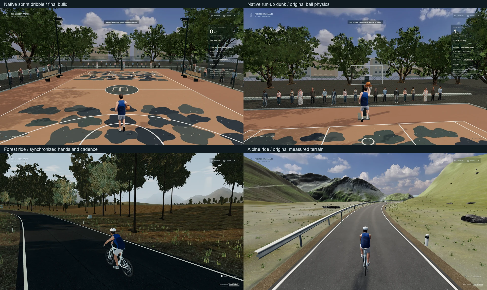

## 体验入口和操作

本机开发预览：

- [篮球](http://127.0.0.1:5190/basketball?view=third)
- [森林骑行](http://127.0.0.1:5190/cycling?view=third)
- [高山骑行](http://127.0.0.1:5190/alpine-ride?view=third)

`5191` 是经过隐私过滤的公开生产构建预览。上述地址需要本机预览服务；本轮没有修改主站入口或部署 GitHub Pages。

| 场景 | 操作 | 行为 |
| --- | --- | --- |
| 三个户外场景 | `V` / 视角按钮 | 切换第一、第三人称；每个场景独立保存偏好 |
| 篮球 | `WASD`、`Shift` | 走跑；持球加速时自动进入更快的运球节奏 |
| 篮球 | `E`、`R` | 靠近拾球 / 运球切换；召回篮球 |
| 篮球 | 按住 `Space` 后松开 | 保留原蓄力投篮和抛物线辅助；锁定鼠标后也可按住左键投篮 |
| 篮球 | `F` | 持球、面向篮筐且在 3.4 米内，从球场一侧上篮 |
| 篮球 | `G` | 持球、面向篮筐、2.8 米内且实际跑速达到 2.2 m/s，从球场一侧扣篮 |
| 骑行 | 靠近自行车后 `E` | 保留原上车过程 |
| 骑行 | `W`、`S`、`Q/E` | 踩踏、渐进刹车、换挡 |
| 骑行 | 鼠标拖动 / 原鼠标锁定 | 看向两侧；第三人称也响应水平和俯仰输入 |
| 骑行 | `P`、`Escape` | 原照片模式与单层退出；暂时隐藏人物，结束后恢复选择的视角 |
| 骑行 | Ride options | 保留连续踩踏、滑行、停靠、舒适模式、下车和返回博物馆 |

上篮与扣篮只定义动作、起跳及释放位置；球继续交给原 `BallPhysics`，**向下穿过篮圈之后才计分**。无球、背对篮筐、站在篮板后面、距离不足或缺少助跑时给出明确提示，不直接增加得分。

## 实际改动

- `src/worlds/presence/`：独立户外视角偏好、逻辑身体眼位与渲染镜头分工、授权骨骼人物、走跑混合、手脚 IK、篮板及支架镜头避障。相机偏移不参与拾球、投篮朝向、碰撞或返回位置计算。
- `src/worlds/court/finishing.ts`、`BasketballCourt.tsx`、`src/world/Player.tsx`：真实加速运球、条件化上篮 / 扣篮；动作可暂停，释放只触发一次，落地后归回原站姿。馆内仍沿原移动链路运行。
- `src/worlds/road/RoadBike.tsx`、`Experience.tsx`：同一实际速度驱动车轮，同一曲柄相位驱动脚部；车把、刹车罩、手部、车架倾斜与上车进度一致。增加轮胎层次、脚踏、线缆、水壶与支架、后拨导轮和原创头盔。
- 两张地图只补齐入口后方的 12 米可见路面，去掉第三人称看见的断头路边缘；物理路线、地形、采样距离与景观分块仍保留。
- `court/lightingPrograms.ts`、`warmPrograms.ts`：进入球场时准备日夜灯光及蒙皮阴影程序，纳入原可取消加载门槛；没有添加常驻渲染通道或额外活动灯光。
- `surfaceDetail.ts`、`court/Surface.tsx`、`court/Trees.tsx`：保留球场涂装及叶片形状，加入原创线性磨损蒙版、干燥粗糙度差异和树冠法线层次。蒙版及其生成脚本有来源说明，不来自视频截图。
- `road/Landscape.tsx`、`alpine/Geography.tsx`、`Delineators.tsx`：草根接地、九叶草簇的方向与根部明暗、路肩矿物色和道路使用痕迹、原路标上的识别带 / 反光片。高山草色与草地法线收敛；DEM、航拍投影、实测日照、物理路线和存档键保留。
- `road/stopApron.ts`：原三个停靠点的铺装沿实际渲染的地形三角面裁切，保持路外间距和 4.5 cm 表面间隙；排除铺装内的草，长椅与标杆按实际坡面接地。位置、停靠时机和骑行控制保留。独立 Three 射线测试检查真实网格关系。
- `scripts/check-third-person-*`、`measure-third-person-play.mjs`：原生输入操作与实机采样；`check-road-journey.mjs` 新增可选 `PALACE_VIEW=third`，默认第一人称流程不变。

没有替换音频引擎、歌词管线、媒体库、数据库、字体、馆标、Cinema、博物馆建筑或原篮球物理。`6380557` 的保留检查仍使用原摘要与明确列出的局部适配，不更新摘要来掩盖变化。

人物来自 [Microsoft Rocketbox](https://github.com/microsoft/Microsoft-Rocketbox)，使用 Sports_Male_04 和原走跑动作，固定来源版本并保留 MIT 许可。它是练习用库存人物，不代表 Jie Tian 或 NBA 球员；见 [来源与许可](../../public/media/presence/SOURCES.md)。没有加入官方游戏模型、Logo、视频帧或商业音频。

## 同机位前后对照

BEFORE 是通过 `git archive` 提取的准确 `e9a3b43` 源码，AFTER 是已包含本轮球场表面修正的实际截图，代码对应 `d55bbca` / `ad6f343`；之后的停靠点修正没有改变球场。统一 Edge、medium、DPR 1、白天与两种视口；使用相同眼位和朝向。截图为实际渲染，只缩放并在画面外加入说明，没有重绘场景像素。

| 视角 | 身体位置 | 看向 |
| --- | --- | --- |
| 入口 | `[2, 1.65, 9]` | `[0, 2.4, -12.1]` |
| 篮筐 | `[2.5, 1.65, -9.3]` | `[0, 3.4, -12.7]` |

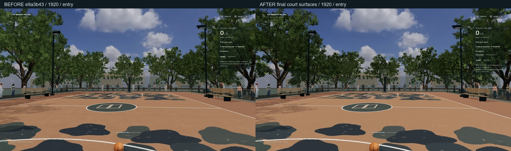
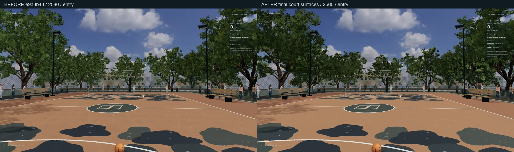
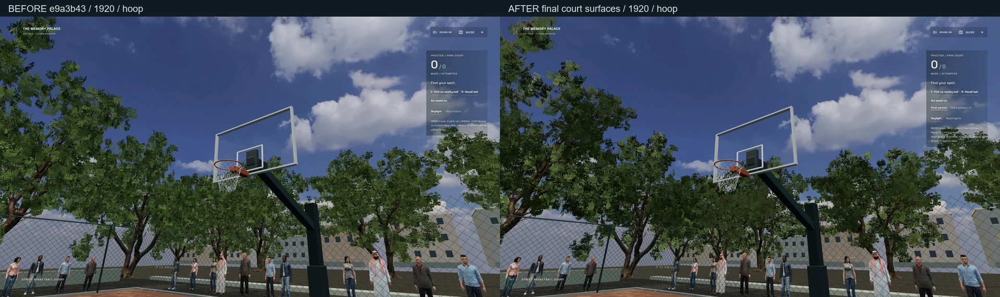
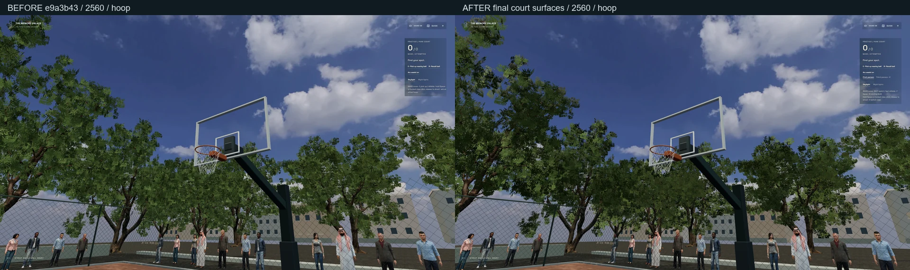

实际查看了两个分辨率的 15 画面并排检查，以及走跑、上篮、扣篮、骑行侧面、照片模式与下车画面。修正了篮板穿入跟随镜头、结束动作未归位、脚部相位、头盔偏低、手与刹车罩距离和上车瞬间人物与车架不一致的问题。

表面细节的单独对照：左为准确的 `d542f14`，右为之后的涂层 / 草地 / 路标修正；共 16 个同机位视角，包含白天、夜间及近处路肩。两种分辨率的实际相机位置和朝向均经过校验，四张拼图逐张查看。

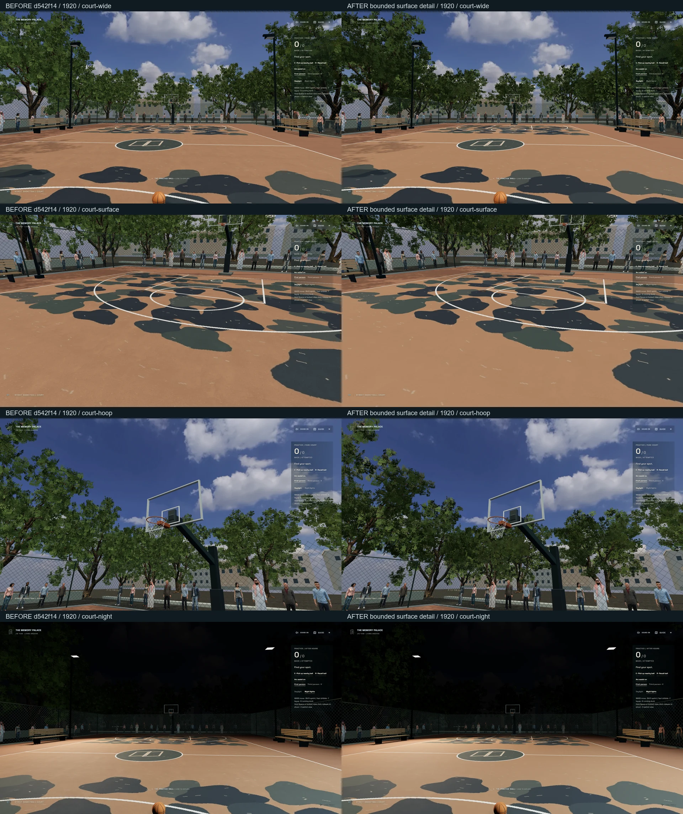
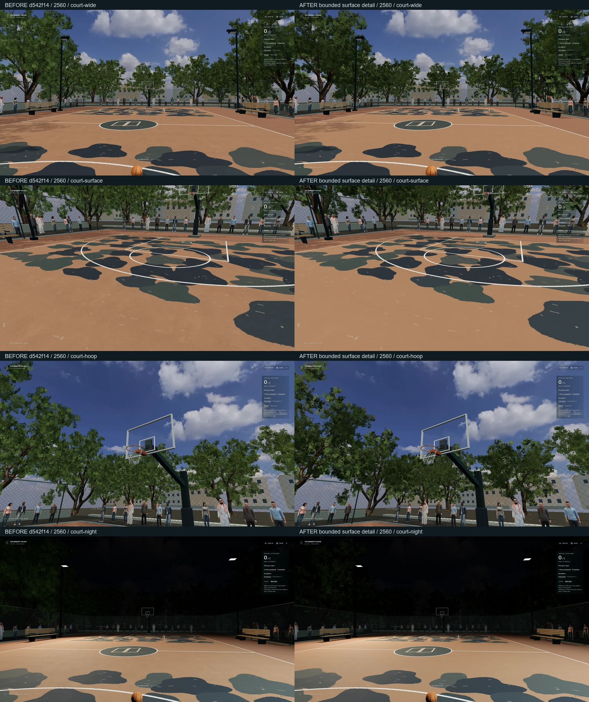
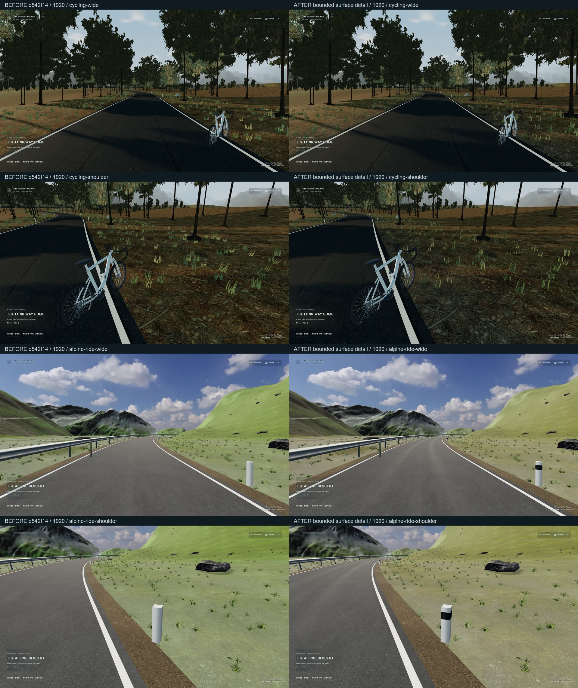
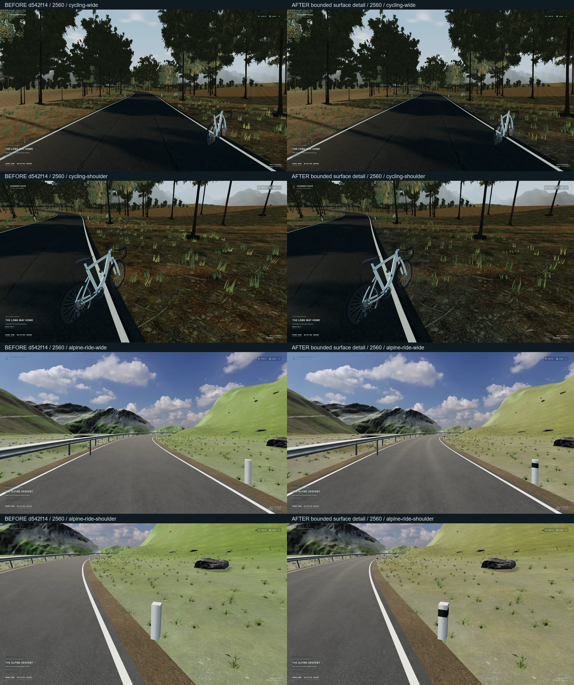

停靠点的单独对照：左为准确的 `668bbfc`，右为 `072cdcf` 对应修正。三处停靠点、两种分辨率共六个机位。静态比较明确恢复测试存档并指定镜头；它用于画面比较，完整骑行另外使用原生输入验收，不由这些静态画面推断。


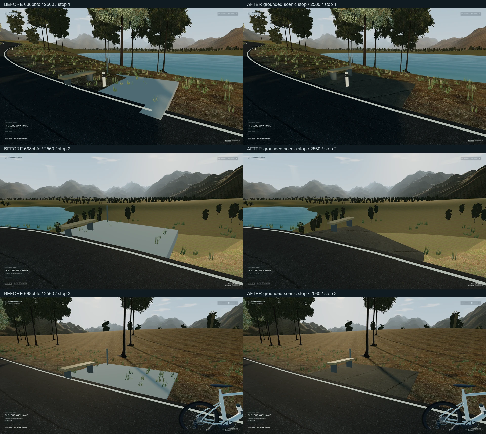

## 验证

2026-10-11 本机执行；完整摘要保存在 `results.json`。

现有 GitHub workflow 的 `pull_request` 触发分支不包含本次叠加 PR 的 `codex/memory-palace-court-fidelity`；以下是本机验证结果，不声称云端 CI 已通过。

- TypeScript、lint、167 项单元测试 / 31 文件通过；包含真实穿框计分、动作暂停 / 取消、IK 可达性、镜头避障、视角存储与保留检查，以及线性蒙版所有权、草根接地、材质装饰与实测日照组合和停靠点真实网格校验。最终命令为 `npm test -- --maxWorkers=2`；首次与其他检查并发时两个文件操作测试触发原 5 秒超时，未修改断言或超时，限制并发后全套通过。
- 1920×1080 和 2560×1440 各三组开发版原生流程通过：加速运球、上篮、跑动扣篮、错误动作反馈、暂停、无查询参数的偏好恢复、两图骑行、换挡、刹车、照片 / Escape、Cinema 原位与距离恢复、下车和返回。
- 原球场第一人称流程两组、原日夜照明四组已通过。
- 最终 `03920ee` 的完整第三人称森林骑行通过：约 3.53 km / 415.497 秒，21 项检查，真实 Web Audio RMS 0.002430；Cinema 返回位置偏差 0.0004115 m、朝向夹角 0.0000005544 rad、路线距离偏差 0。没有注入路线进度或速度，最后单独标记的无效状态测试验证原恢复链路；关闭长录屏，保留沿途 18 个时刻的截图 / 数据和短合成环境音记录，不声称有完整行程视频。
- 最终公开版六组流程连续两轮通过：1080p / 1440p 原生助跑扣篮、视角刷新恢复、两图骑行 / 照片 / 单层退出 / 返回，均没有开发调试接口或物理注入。最终一轮源码为 `4b6ab2f`，无浏览器错误和上传请求；两种分辨率实际助跑约 3.28 / 3.23 秒后动作被接受。
- 最终旧入口 / Guide / 原投篮 / 日夜存档 / Pointer Lock 五项通过。`build:public` 通过并保留 66 个分享路由 / 52 个索引页；最后的隐私扫描确认五类私人清单均为空，私有音频、歌词和文档为零，旧入口与两图入口仍存在。

公开构建继续过滤全部私人清单、HTML、歌词、音乐与浏览器导入。测试只使用已公开素材和合成环境音；测试浏览器没有上传请求。原始截图、视频、报告与本机缓存保存在忽略的 `qa-artifacts/`，Git 仅包含公开场景证据和精选摘要。

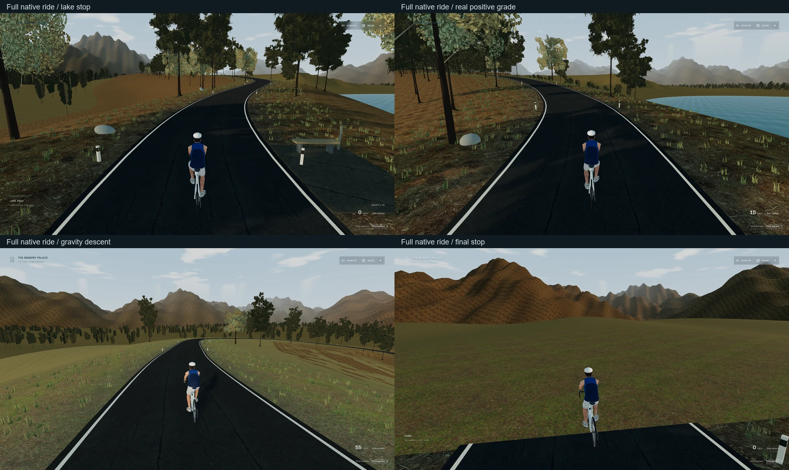

最终长路线验收第一次在约 93% 进度达到原超时，失败记录保留。补充显式测试浏览器参数及可见性 / 焦点 / 帧更新诊断后，完整 21 项回测通过；没有修改应用的物理速度、暂停行为或验收断言。公开流程最初两次 1440p 助跑也未在原时间窗内被接受；补充只读输入 / RAF 诊断后，单独 1440p 及完整两轮六组流程通过。未证明这些间歇失败的根因，不能据此宣称修复了应用物理或浏览器缺陷。此前一次无头浏览器提前关闭也保留在原始诊断，不猜测其进程关闭原因。

复验命令（PowerShell，先分别启动开发 `5190`、公开预览 `5191`；性能脚本还需准确基线 `5192`）：

```powershell
npm test -- --maxWorkers=2
npx tsc -b
npm run lint
$env:PALACE_HEADED='1'
node scripts/check-third-person-play.mjs
$env:PALACE_VIEW='third'
node scripts/check-road-journey.mjs
npm run build:public
node scripts/check-third-person-public.mjs
node scripts/check-worlds-production.mjs
node scripts/check-alpine-public.mjs
node scripts/measure-third-person-play.mjs
```

不要在完整骑行或性能测试期间重建 / 注册素材，以免开发服务器刷新场景；不要并行开启多个 GPU 测试。公开构建之后可运行 `npm run media:register` 恢复本机开发素材，私人文件仍保留在原位置。

## 性能范围

可见 Edge 148.0.3967.70 / Playwright 1.63.0，实际 NVIDIA GTX 1650 / ANGLE D3D11，1920×1080，medium，DPR 1。以下是最终源码的同轮基线与新版 5–7 秒短采样：按 `renderer.info.render.frame` 的实际更新计数，重复 RAF 不计为渲染帧。九段均没有隐藏 / 失焦帧或重复计数。它不是无头成绩、GPU timer、完整显存计数或长时间稳定性保证。

测试浏览器保留当前 Playwright 默认功能参数，仅追加关闭 Windows 原生窗口遮挡计算；旧版、新版使用相同配置。这不修改用户常用浏览器或应用。此前只记录页面焦点仍出现 1 Hz 更新；相同步行在该参数对照下，从 15 秒约 2 米恢复到约 3 秒接近车辆。该实验与 [Chromium 的原生遮挡节流机制](https://chromium.googlesource.com/chromium/src/+/main/ui/base/ui_base_features.cc) 一致；完整参数与失败轮保存在摘要中，不把只读诊断冒充应用性能优化。

| 场景 | 平均 FPS | p95 ms | 最大帧间隔 ms | 主通道 draw calls | 三角形 | 活动灯 / 阴影灯 |
| --- | ---: | ---: | ---: | ---: | ---: | ---: |
| 基线第一人称球场 | 142.3 | 7.1 | 27.7 | 96 | 1,125,487 | 2 / 1 |
| 新版第一人称球场 | 142.3 | 7.1 | 27.8 | 96 | 1,125,487 | 2 / 1 |
| 第三人称白天 | 135.5 | 13.8 | 27.8 | 118 | 1,138,283 | 2 / 1 |
| 第三人称首次夜间 | 123.6 | 13.9 | 111.0 | 118 | 1,138,283 | 3 / 1 |
| 夜间原生加速运球（含边界停步） | 118.0 | 13.9 | 41.7 | 120 | 1,138,499 | 3 / 1 |
| 森林第三人称静止 | 120.1 | 13.9 | 41.6 | 153 | 2,226,184 | 2 / 1 |
| 森林第三人称踩踏 | 118.1 | 14.0 | 41.7 | 153 | 2,226,184 | 2 / 1 |
| 高山第三人称静止 | 114.8 | 14.0 | 62.3 | 184 | 2,254,500 | 2 / 1 |
| 高山第三人称踩踏 | 117.6 | 13.9 | 48.6 | 189 | 2,309,912 | 2 / 1 |

早期冷启动测试发现首次夜间切换会出现 2.2–2.9 秒停顿；补全灯光与蒙皮阴影程序准备后，多次短采样未再出现同样的秒级切换停顿，但首次夜间仍有 **90–153 ms** 峰值（最终轮 111 ms），不能称为完全无卡顿。准备更多程序会增加首次加载工作，仍通过原关键资源门槛呈现。

另保留一轮异常采样：旧版 129.9 FPS、新版第一人称 40.9 FPS、第三人称白天 29.2 FPS，最大 RAF 间隔约 1007 ms，随后夜间约 120.5 FPS；该轮在骑行接近车辆时超时，未完成九段，不作为完整硬件验收。补充只读可见性诊断的下一轮球场约 104.7–131.8 FPS，但同样未完成骑行。最终使用上述遮挡参数对照并记录实际渲染计数，九段全部完成；早期异常没有被删除，也没有选取单个高帧率替代整轮报告。

纹理采样估算：球场由约 213.2 MiB 增至 242.5 MiB，森林约 57.0 MiB，高山约 182.1 MiB；这是已引用材质图像及 mip 估算，未涵盖渲染目标、全部缓存与驱动内存，不等同实际显存占用。最终球场第一人称 / 第三人称白天 / 夜间的纹理数为 52 / 63 / 64，程序数为 155 / 156 / 183。地形停靠点没有增加纹理或灯光。

采样记录的 Git HEAD 为 `4b6ab2f`，运行时源码最后改动为 `072cdcf`。当时工作区包含随后提交为 `4edb70d` 的只读测量脚本修改及未跟踪文档，没有未提交的运行时源码 / 素材变更。

## 具体限制

- 本轮是自由练习；没有 1V1 对手、防守 AI 或比赛规则。
- 上篮、扣篮与骑姿使用原骨骼动作之上的程序约束；没有完整动作捕捉、单独手指抓握或职业球员动作库，不能声称与 NBA 2K 画质和动作完全相同。
- 镜头避障针对现有篮板及支架，骑行有地形高度保护；没有新增全场通用相机物理系统。
- 保留两张现有地图并完善车辆与观看细节，没有将地图替换成视频拍摄地点的真实三维扫描。
- 森林远山与远林仍是原有简化几何 / 图像陈列，高山远处航拍的分辨率也有限；本轮没有解决所有远景锐度或树冠细节，不能称为照片级场景。
- 森林终点保留原停止边界；尽头的空间收束与远景几何仍有进一步完善的空间。
- 1440p 已验证布局与操作；未做 1440p 长时硬件基准、移动设备性能、所有设备 / 驱动组合测试。
- 原音频、导入、歌词等保护测试通过；本轮没有重新导入或上传用户本机歌曲与私人图片。

## 小提交

| 提交 | 内容 |
| --- | --- |
| `ed2e027` | 授权人物与经测试的视角 / IK 基础 |
| `6788215` | 第三人称、近框动作与同步骑行 |
| `c6f030d` | 姿态归位、持续观看与车辆接触修正 |
| `60854e9` | 开发与公开原生操作验收 |
| `f12de77` | 真实场景就绪门槛及第三人称长路线测试入口 |
| `feb619b` | 球场灯光 / 蒙皮阴影程序准备 |
| `68b7289` | 篮板与支架镜头避障、无查询参数的偏好恢复验收 |
| `d542f14` | Cinema 返回用旋转夹角比较等价四元数 |
| `d55bbca` | 球场涂层、树冠光照与原始来源 |
| `ad6f343` | 草根、路肩、米制磨损与原路标细节 |
| `cd36749` | 提前保存完整骑行测试诊断 |
| `668bbfc` | 可见 Edge 的公共流程验收入口 |
| `072cdcf` | 实际地形上的停靠点铺装、长椅与植被排除 |
| `a2393c6` | 可见 Edge 的完整骑行验收入口 |
| `03920ee` | 完整路线测试隔离浏览器后台节流并保留状态诊断 |
| `4b6ab2f` | 公共流程的只读输入 / 帧诊断与视口复验 |
| `4edb70d` | 记录真实渲染帧、默认参数及原生遮挡对照的可见硬件采样 |
